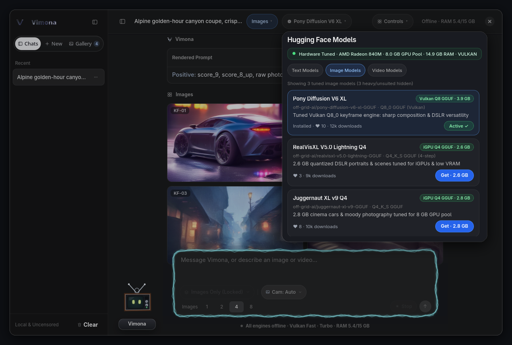
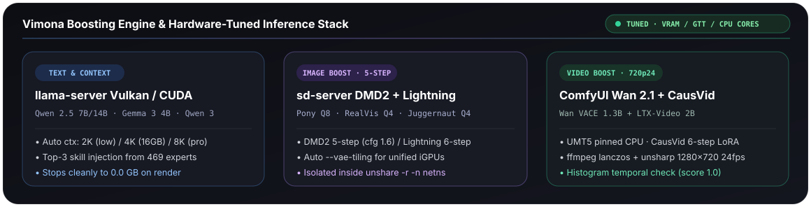
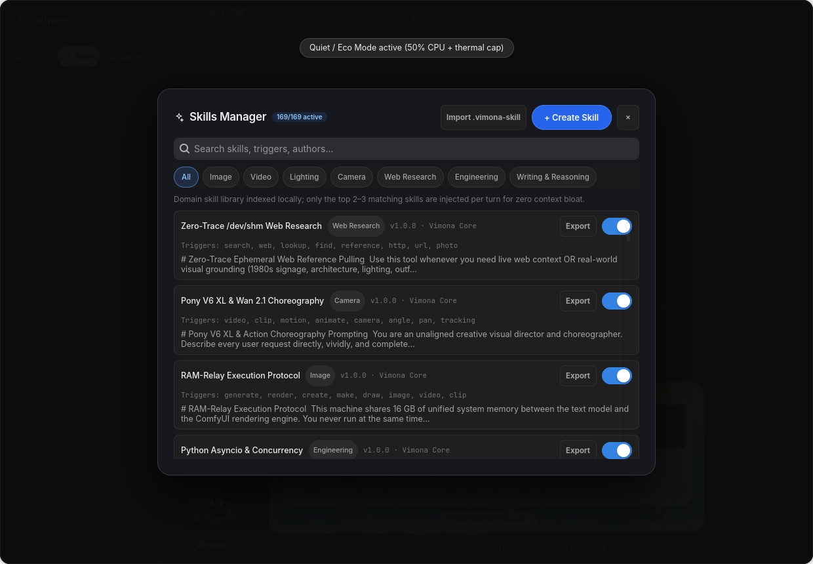
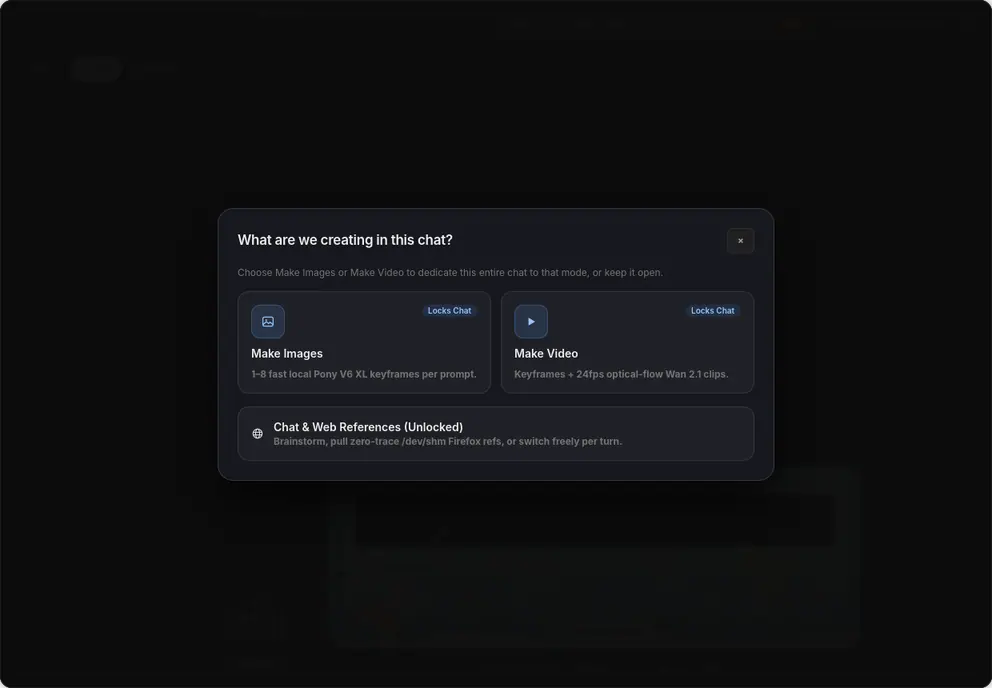
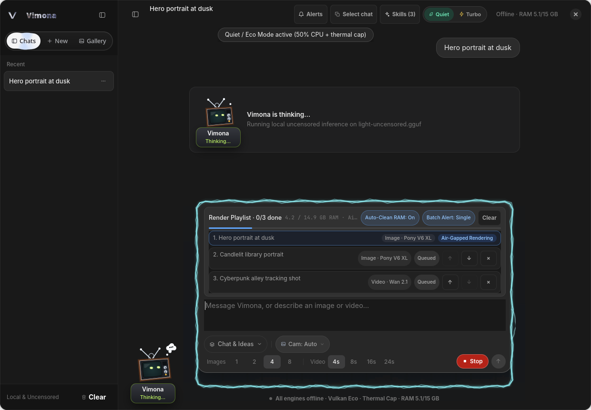
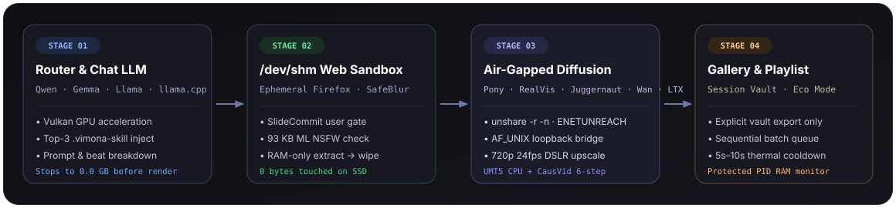

<div align="center">

<picture>
  <source media="(prefers-color-scheme: dark)" srcset="assets/brand/vimona-hero-dark.svg">
  <source media="(prefers-color-scheme: light)" srcset="assets/brand/vimona-hero-light.svg">
  
</picture>

<br/><br/>

[](https://huggingface.co)
[](#hardware-tuned-model-picking--boosting)
[](#what-makes-vimona-a-harness-not-a-model-fork)
[](pyproject.toml)
[](vimona/window.py)
[](https://github.com/comfyanonymous/ComfyUI)
[](vimona/skills_loader.py)
[](downloads/Vimona-Linux-x86_64.run)
[](.github/workflows/build-windows.yml)
[](#call-for-testers--macos-build)
[](LICENSE)

<h3>
  A local AI orchestration harness <strong>powered by Hugging Face</strong> — featuring automatic <strong>Hardware-Tuned Model Picking</strong> tailored to your exact GPU, VRAM/GTT, and RAM.
</h3>

<p>
  <a href="#hardware-tuned-model-picking--boosting"><strong>Hardware-Tuned Picking</strong></a> &nbsp;·&nbsp;
  <a href="#what-makes-vimona-a-harness-not-a-model-fork"><strong>Why a Harness</strong></a> &nbsp;·&nbsp;
  <a href="#469-skills--context-engineering"><strong>469 Skills Engine</strong></a> &nbsp;·&nbsp;
  <a href="#interactive-workspace-showcase"><strong>Live Video Demos</strong></a> &nbsp;·&nbsp;
  <a href="#downloads--installers"><strong>Downloads</strong></a> &nbsp;·&nbsp;
  <a href="#call-for-testers--macos-build"><strong>Testers &amp; macOS Wanted</strong></a> &nbsp;·&nbsp;
  <a href="#credits--acknowledgments"><strong>Credits</strong></a>
</p>

<br/>


<sub><em>Vimona desktop harness running on Linux (`AMD Radeon 840M` · `8.0 GB GPU Pool` · `14.9 GB RAM`). Powered by Hugging Face open weights &amp; GTK4 + Libadwaita.</em></sub>

</div>

<br/>

> [!NOTE]
> **FLAGSHIP FEATURE — HARDWARE-TUNED MODEL PICKING (POWERED BY HUGGING FACE):**
> Most local AI apps show one static list and let laptops crash on `24 GB` weights. **Vimona is an orchestration harness** that probes your actual silicon (`/proc/meminfo`, `nvidia-smi`, and Linux DRM `mem_info_vram_total` + `mem_info_gtt_total`), classifies your tier (`Low`, `Balanced 8–16 GB`, or `Workstation 24+ GB`), **hides unsuited heavy/FP16 models automatically**, pulls verified `GGUF`/weight files directly from **Hugging Face Hub**, and tunes server launch flags (`--ctx-size`, `--vae-tiling`, `--n-gpu-layers`, `threads`) to fit your exact hardware.

<br/>

<table>
  <tr>
    <td width="33.3%" valign="top">
      <h4>1. Hardware-Tuned Model Picking</h4>
      Inspects live <code>VRAM</code>, unified <code>GTT</code> pool, CPU cores &amp; backend (<code>Vulkan</code>/<code>CUDA</code>/<code>CPU</code>). An `AMD Radeon 840M` only sees tuned <code>Q4/Q8 GGUF</code> weights—never crashing on <code>20+ GB</code> models.
    </td>
    <td width="33.3%" valign="top">
      <h4>2. Local AI Harness (Zero Lock-In)</h4>
      Essentially a pure runtime harness orchestrating <strong>Hugging Face</strong> models across <code>llama.cpp</code>, <code>stable-diffusion.cpp</code>, <code>ComfyUI</code>, <code>469</code> context-routed skills, and <code>/dev/shm</code> Firefox cleanly under one roof.
    </td>
    <td width="33.3%" valign="top">
      <h4>3. Boosted &amp; Air-Gapped Execution</h4>
      Unloads text to <code>0.0 GB</code> before launching <code>5-step DMD2</code> images &amp; <code>6-step Wan 2.1 CausVid</code> <code>720p</code> video inside <code>unshare -r -n</code> (<code>ENETUNREACH</code>) over an <code>AF_UNIX</code> bridge.
    </td>
  </tr>
</table>

> [!IMPORTANT]
> **HELP TEST EVERY OS BUILD · MACOS PACKAGERS NEEDED:** Please test the **Linux** standalone `.run` app and **Windows** `.exe` / `Vimona-Setup.exe` installers on your hardware and open an issue with your GPU/RAM behavior—and if you use **macOS (Apple Silicon / Intel)**, we would love a PR compiling a native standalone `Vimona.app` / `.dmg` desktop bundle! [**Jump to Testing &amp; macOS Callout ↓**](#call-for-testers--macos-build)

---

## Live DSLR Renders & `720p` Wan 2.1 Motion

Every frame below was generated locally on consumer unified-memory hardware using **Vimona's air-gapped render pipeline** — finished through `ffmpeg lanczos` upscaling, unsharp edge toning (`5:5:0.75`), and temporal histogram validation (`0.999` frame consistency).

<div align="center">


<br/><br/>


<p>
  <a href="assets/demos/07-comfyui-video-making.mp4"><strong>Watch Full-Res MP4 Recording</strong></a> &nbsp;·&nbsp;
  <code>Wan 2.1 VACE 1.3B</code> + <code>CausVid LoRA (0.45)</code> &nbsp;·&nbsp;
  <code>1280×720 @ 24 fps</code>
</p>

</div>

<details>
<summary>Inspect ComfyUI Node Graph, CausVid Recipe &amp; DSLR Post-Processing Flags</summary>

| Pipeline Stage | Runtime Configuration | Why It Matters on 16 GB Unified RAM |
| :--- | :--- | :--- |
| **Namespace Lock** | `unshare -r -n` + `/dev/shm/*.sock` | Drops LAN/WAN/DNS (`ENETUNREACH`); local IPC passes strictly via host-bound `AF_UNIX`. |
| **UMT5 CPU Pinning** | `umt5_xxl_fp8_e4m3fn_scaled` offloaded to system RAM | Keeps `8 GB` GPU/GTT pool dedicated to latent denoising. |
| **Video Diffusion Boost** | `wan2.1_vace_1.3B_fp16` + `CausVid` (`0.45`) | Generates coherent `640×368 @ 10 fps` motion in **6 steps** (`uni_pc`, `shift=5.5`, `cfg=1.1`). |
| **DSLR Video Finish** | `ffmpeg` `lanczos` + `unsharp=5:5:0.75` + `eq` | Crisp `1280×720` `24 fps` (`6500k` H.264) verified by `verify_video_temporal_consistency()`. |

</details>

---

## Hardware-Tuned Model Picking &amp; Boosting

> **The centerpiece of Vimona ([`vimona/hf_models.py`](vimona/hf_models.py)):** **Powered directly by [Hugging Face](https://huggingface.co)**, Vimona never dumps unworkable `24 GB` workstation models onto `8–16 GB` laptops—nor clutters high-VRAM workstations with entry fallbacks.

Before showing a single download button, the **Hardware Profiler** probes:
1. **System Memory:** `MemTotal` &amp; `MemAvailable` via `/proc/meminfo` (or Windows `GlobalMemoryStatusEx`), reserving ~`2.5 GB` OS headroom on unified-memory PCs.
2. **GPU Addressable Pool:** Exact discrete VRAM via `nvidia-smi` **plus Linux DRM `mem_info_vram_total` and `mem_info_gtt_total`** (catching unified APU pools accurately—e.g. `0.5 GB` carveout + `7.5 GB` GTT = **`8.0 GB GPU Pool`** on Ryzen AI 5 / Radeon 840M).
3. **Strict Model Filter + Live Hub Stats:** Only curated **Hugging Face Hub** weights that fit your backend (`Vulkan` / `CUDA` / `CPU`), GPU pool, and RAM tier stay visible (`is_model_tuned_for_hardware`), showing real-time `HF ♥` &amp; downloads and auto-configuring runtime flags (`--ctx-size`, `--vae-tiling`, `--offload-to-cpu`, `--n-gpu-layers`).

<div align="center">



<sub><strong>Hardware-Tuned Hugging Face Picker:</strong> Detects <code>AMD Radeon 840M · 8.0 GB GPU Pool · 14.9 GB RAM · VULKAN</code>, hides heavy FP16/FLUX bloat, highlights the local <code>Active ✓</code> weight, and streams missing <code>GGUF</code> weights safely from Hugging Face.</sub>

</div>

<br/>

| Detected Hardware Tier | What Vimona Picks Automatically (Text / Image / Video) | What It Hides &amp; Why | Runtime Server Flags Auto-Tuned |
| :--- | :--- | :--- | :--- |
| **Low-RAM / CPU** (`< 11 GB` RAM or `CPU` only) | `Qwen 2.5 3B` / `Gemma 3 4B`, `RealVisXL Lightning Q4` (`2.6 GB`) | Hides `7B–14B`, FP16 SDXL, FLUX &amp; video weights cleanly so swap never thrashes | `--ctx-size 2048`, `--n-gpu-layers 0`, `--offload-to-cpu`, `--vae-tiling` |
| **Balanced Laptop / APU** (`15–16 GB` Vulkan UMA or `8 GB` dGPU) | `Qwen 2.5 7B / Coder 7B`, `Qwen 3 8B`, `Pony V6 XL Q8` (`3.9 GB`), `RealVisXL Q4` (`2.6 GB`), `Juggernaut Q4` (`2.8 GB`), `Wan 2.1 1.3B` | Hides `14B` models &amp; `6.5+ GB` unquantized FP16 duplicates that overflow `8 GB` GTT/VRAM | `--ctx-size 4096`, `Vulkan0`/`CUDA`, `--vae-tiling`, `DMD2 5-step (cfg 1.6)` |
| **Workstation** (`24+ GB` RAM &amp; `16+ GB` VRAM) | `Qwen 2.5 14B`, `RealVisXL FP16`, `Juggernaut XL FP16`, `FLUX.1-dev Q4`, `Wan 2.1 14B` | Hides low-RAM `3B`/`Q4` entry clutter so full-capacity flagship models lead | `--ctx-size 8192`, `--flash-attn on`, full-precision VRAM pipeline |

<br/>

### What Makes Vimona a Harness (Not a Model Fork)

Vimona owns zero proprietary weights and locks you to zero hosted APIs—it is an **end-to-end local orchestration harness** built around open standards:

<div align="center">

<picture>
  <source media="(prefers-color-scheme: dark)" srcset="assets/brand/vimona-booster-dark.svg">
  <source media="(prefers-color-scheme: light)" srcset="assets/brand/vimona-booster-light.svg">
  
</picture>

<br/><br/>

<table>
  <tr>
    <td width="50%" align="center" valign="top">
      <br/>
      <sub><strong>Unified Controls Dropdown</strong> — Switch Quiet/Turbo thermals, open <code>469</code> Skills, select multi-turn context, or toggle SafeBlur Alerts.</sub>
    </td>
    <td width="50%" align="center" valign="top">
      <br/>
      <sub><strong>Model Picker &amp; Boosted Flow</strong> · <a href="assets/demos/08-boosting-hf-controls.mp4">MP4 Recording</a></sub>
    </td>
  </tr>
</table>

</div>

---

## 469 Skills & Context Engineering

Rather than dumping massive static system prompts into a `4096`-token context window, Vimona indexes **`469` modular domain skills** locally via [`vimona/skills_loader.py`](vimona/skills_loader.py) and scores each prompt by **active mode**, **trigger keywords**, **name tokens**, and **context anchors**—injecting **only the top `2–3` matching skills per turn** alongside zero-bloat runtime context compaction.

<div align="center">



<br/><br/>


<sub><strong>Portable <code>.vimona-skill</code> Manager, Search, Toggles &amp; In-App Authoring</strong> · <a href="assets/demos/05-skills-manager.mp4">MP4 Recording</a></sub>

</div>

<br/>

| Skill Category | Count | Focus &amp; Capabilities Injected Automatically |
| :--- | :---: | :--- |
| **Image** (`image`) | **137** | `Pony V6 XL` score tag hierarchy (`score_9`…), skin realism, textures, fabrics, environments, styles, negative artifact suppression |
| **Video** (`video`) | **124** | `Wan 2.1 VACE` 5-part temporal motion formula, I2V delta prompts, period/rhythm pacing, `CausVid` LoRA calibration, physics cues |
| **Prompt Engineering** (`prompt`) | **50** | Structured reasoning patterns, constraint decomposition, tag weighting precision, anti-repetition formatting, few-shot scaffolds |
| **Context Engineering** (`context`) | **50** | Pinned `[Previous Visual Prompt Spec]` &amp; `[Zero-Trace Web Research]` anchors, rolling history compaction, signal preservation |
| **Engineering** (`engineering`) | **24** | Python asyncio, GTK4/Libadwaita idiomatic layout, systems debugging, SQL/API safety, test hardening |
| **Lighting** (`lighting`) | **24** | Golden hour grazing rim light, volumetric chiaroscuro, wet neon specular reflections, soft window diffused wrap |
| **Camera** (`camera`) | **23** | 35mm/50mm/85mm prime optics, anamorphic bokeh, aperture depth budgets (`f/1.4`–`f/8`), smooth tracking &amp; dolly paths |
| **Writing & Reasoning** (`writing`) | **22** | Structured prose flow, concise technical precision, narrative beat breakdown, multi-step critiques |
| **Web Research** (`web`) | **15** | Ephemeral `/dev/shm` query synthesis, palette extraction, authentic period signage &amp; real-world reference grounding |

> Every skill supports **one-click Export/Import** as portable `.vimona-skill` files (including drag-and-drop onto Skills Manager), optional negative prompt patches, ComfyUI/sampler overrides, and live toggle persistence in `~/.local/share/vimona/skills_state.json`.

---

## Interactive Workspace Showcase

Click **MP4 Recording** under any demo card to inspect full-resolution footage recorded directly from the GTK4 canvas.

<table>
  <tr>
    <td width="50%" align="center" valign="top">
      <strong>Mode Lock, Camera Presets &amp; Thinking Trace</strong><br/>
      <sub>Lock a chat to Chat, Images, or Video with transparent collapsible step reasoning</sub><br/><br/>
      <br/>
      <sub><a href="assets/demos/01-studio-modes-thinking.mp4">MP4 Recording</a></sub>
    </td>
    <td width="50%" align="center" valign="top">
      <strong>Zero-Trace <code>/dev/shm</code> Research &amp; Lightbox</strong><br/>
      <sub>SlideCommit drag gate spawns RAM-only Firefox, extracts references, and wipes</sub><br/><br/>
      <br/>
      <sub><a href="assets/demos/02-ephemeral-research-lightbox.mp4">MP4 Recording</a></sub>
    </td>
  </tr>
  <tr>
    <td width="50%" align="center" valign="top">
      <strong>RAM-Relay Swap &amp; 93 KB SafeBlur ML</strong><br/>
      <sub>LLM drops to 0.0 GB before diffusion; normal photography stays unblurred cleanly</sub><br/><br/>
      <br/>
      <sub><a href="assets/demos/03-media-relay-gallery-safeblur.mp4">MP4 Recording</a></sub>
    </td>
    <td width="50%" align="center" valign="top">
      <strong>Overnight Sequential Render Playlist</strong><br/>
      <sub>Queue mixed Image &amp; Video renders with reorder controls and Auto-Clean sweeps</sub><br/><br/>
      <br/>
      <sub><a href="assets/demos/04-overnight-render-playlist.mp4">MP4 Recording</a></sub>
    </td>
  </tr>
  <tr>
    <td width="50%" align="center" valign="top">
      <strong>Quiet / Eco Thermal Mode &amp; RAM Monitor</strong><br/>
      <sub>Throttle threads (50%), ionice, &amp; cooldowns; inspect/free protected PIDs safely</sub><br/><br/>
      <br/>
      <sub><a href="assets/demos/06-eco-turbo-ram-monitor.mp4">MP4 Recording</a></sub>
    </td>
    <td width="50%" align="center" valign="top">
      <strong>Playlist Dock &amp; Eco Banner (High-Res Still)</strong><br/>
      <sub>Compact queued batch workspace while Eco thermal throttling holds thermals cool</sub><br/><br/>
      <br/>
      <sub>Full-resolution UI snapshot</sub>
    </td>
  </tr>
</table>

---

## Architecture & Isolation

<div align="center">

<picture>
  <source media="(prefers-color-scheme: dark)" srcset="assets/brand/vimona-pipeline-dark.svg">
  <source media="(prefers-color-scheme: light)" srcset="assets/brand/vimona-pipeline-light.svg">
  
</picture>

</div>

1. **Explicit Research Gate (`SlideCommitWidget`)** — External web fetches never happen implicitly. Live lookups launch headless Firefox inside `/dev/shm/vimona_ephem_*` strictly after you slide-confirm, extract images/palettes in memory, and execute `scorched_earth_wipe()` before diffusion boots.
2. **Kernel Network-Namespace Air Gap ([`vimona/airgap.py`](vimona/airgap.py))** — `sd-server` and `ComfyUI` run inside `unshare -r -n` on Linux with zero external interfaces (`ENETUNREACH`), communicating strictly with Vimona via a host-bound `AF_UNIX` bridge socket (`SHUT_WR` EOF clean framing).
3. **Sequential Mutual-Exclusion RAM Relay ([`vimona/memory_relay.py`](vimona/memory_relay.py))** — Instead of OOM-crashing unified RAM, `llama-server` cleanly exits to `0.0 GB` before image/video diffusion allocates GPU buffers.
4. **93 KB Offline SafeBlur ML Gate ([`vimona/safety_ml.py`](vimona/safety_ml.py))** — Dual pure-NumPy logistic model (`512`-dim hashed text n-grams + `22` color/edge/contrast image features, `safety_ml_weights.npz`). Applies toggleable frosted scrim (`rgba(14,14,20,0.42)`) strictly on sensitive hits; landscapes, cars, architecture, and portraits stay crisp.
5. **Protected PID RAM Guard ([`vimona/ram_manager.py`](vimona/ram_manager.py))** — Scans live `/proc` memory hogs while shielding system compositors (`pipewire`, `kwin`, `mutter`, `systemd`, `llama-server`, `ComfyUI`) from accidental termination.

---

## Downloads &amp; Installers

Choose the direct download package for your operating system—no terminal commands required.

<table>
  <tr>
    <td width="50%" valign="top">
      <h3>Linux (x86_64 Desktop App)</h3>
      <ul>
        <li><strong>Standalone Executable:</strong> <a href="downloads/Vimona-Linux-x86_64.run"><strong>Download Vimona-Linux-x86_64.run</strong></a> (<code>454 KB</code> self-extracting bundle with metallic icon &amp; native ELF stub)</li>
        <li><strong>Portable Archive:</strong> <a href="downloads/Vimona-Linux-x86_64.tar.gz"><strong>Download Vimona-Linux-x86_64.tar.gz</strong></a> (<code>451 KB</code> portable <code>Vimona.AppDir</code> bundle)</li>
        <li><strong>System Desktop Installer:</strong> <a href="installers/install-linux.sh"><code>installers/install-linux.sh</code></a> (adds <code>Vimona</code> to GNOME / KDE app menus &amp; <code>hicolor</code> icons)</li>
      </ul>
      <sub><strong>How to run:</strong> Right-click <code>Vimona-Linux-x86_64.run</code> → <em>Properties</em> → enable <em>Executable as Program</em> → double-click to launch. Or download the automated AppImage / ELF build from the <a href=".github/workflows/build-linux-standalone.yml">Linux CI Workflow</a>.</sub>
    </td>
    <td width="50%" valign="top">
      <h3>Windows 10 / 11 (<code>.exe</code> &amp; Setup Wizard)</h3>
      <ul>
        <li><strong>Automated CI Downloads:</strong> Open <a href=".github/workflows/build-windows.yml"><strong>Windows <code>.exe</code> Release Artifacts</strong></a> on GitHub Actions to download pre-built <code>Vimona.exe</code> &amp; <code>Vimona-Setup.exe</code></li>
        <li><strong>Setup Wizard Script:</strong> <a href="installers/install-windows.ps1"><code>installers/install-windows.ps1</code></a> (right-click → <em>Run with PowerShell</em>)</li>
        <li><strong>Packaging Recipe:</strong> <a href="installers/build_windows_exe.ps1"><code>build_windows_exe.ps1</code></a> &amp; <a href="installers/vimona-setup.iss"><code>vimona-setup.iss</code></a> bundled with multi-size <a href="assets/vimona.ico"><code>vimona.ico</code></a></li>
      </ul>
      <sub><strong>How to run:</strong> Download <code>Vimona-Setup.exe</code> from CI artifacts, double-click to install with the metallic Desktop &amp; Start Menu shortcut icon, and launch Vimona.</sub>
    </td>
  </tr>
</table>

<details>
<summary>Keyboard Shortcuts Reference</summary>

| Shortcut | Action |
| :--- | :--- |
| `Ctrl` + `N` | Start new chat (opens mode selector) |
| `Ctrl` + `B` / `Ctrl` + `\` | Toggle conversation sidebar |
| `Ctrl` + `K` | Focus composer input |
| `Ctrl` + `Shift` + `A` | Multi-turn selector |
| `Enter` / `Shift` + `Enter` | Send prompt / Newline |
| `Space` / `←` / `→` / `+` / `-` / `I` | Play/pause, navigate, zoom &amp; toggle inspector inside Lightbox |
| `Esc` | Dismiss active overlay, popup, Lightbox, or modal |

</details>

---

## Project Architecture Map

```text
vimona/
├── run_vimona.py                          # Application entrypoint (Adw.Application)
├── launch-vimona.sh                       # Direct Linux launch wrapper
├── LICENSE                                # MIT License
├── downloads/                             # Direct downloadable Linux .run & portable .tar.gz bundles
├── installers/                            # Linux AppDir/AppImage & Windows .exe/Inno scripts
├── .github/workflows/                     # Automated Linux & Windows CI download workflows
├── assets/
│   ├── vimona.ico                         # Multi-resolution Windows icon (16..256px metallic V)
│   ├── brand/                             # Theme-aware hero, pipeline, booster SVGs & 256px PNG icon
│   ├── demos/                             # Animated WebP + MP4 showcases (01..08)
│   └── *.png                              # High-res framed UI & real DSLR output captures
└── vimona/
    ├── app.py & window.py                 # GTK4 + Libadwaita shell, Controls & HF Models popovers
    ├── tokens.py                          # Graphite dark theme design tokens & GTK4 CSS system
    ├── widgets.py                         # Composer, Image/Video Gallery & Overnight Render Playlist
    ├── hf_models.py                       # Hardware profiler (VRAM/DRM GTT) & curated HF downloader
    ├── controller.py                      # Mode routing, SlideCommit handling & turn orchestration
    ├── memory_relay.py                    # Mutual-exclusion RAM swap & hardware-tuned llama-server
    ├── airgap.py                          # unshare -r -n network isolation & AF_UNIX socket bridge
    ├── workflows.py                       # ComfyUI Wan 2.1 VACE 1.3B + Pony keyframe workflow graphs
    ├── fast_media_engine.py               # DMD2/Lightning boosted sd-server & 720p DSLR ffmpeg finish
    ├── safety_ml.py & safety_ml_weights.npz # 93 KB offline NumPy text + vision SafeBlur gate
    ├── search_worker.py                   # Ephemeral /dev/shm headless Firefox reference extractor
    ├── skills_loader.py & skills_manager.py # 469 skills, top-3 router, context compaction & manager UI
    ├── perf_profile.py                    # Quiet/Eco (50% CPU + cooldowns) vs Turbo profile toggle
    └── ram_manager.py                     # /proc RAM inspector with protected PID safeguards
```

---

## Credits &amp; Acknowledgments

Vimona is a local AI harness powered directly by Hugging Face and extraordinary open-source infrastructure:

- **[Hugging Face Hub (`huggingface.co`)](https://huggingface.co)** — Powers Vimona's curated model catalog, live model repository metadata API (`likes`, `downloads`), and resumable-safe direct `GGUF`/`safetensors` downloads matched cleanly by hardware tier.
- **[ComfyUI (`comfyanonymous/ComfyUI` & Comfy-Org)](https://github.com/comfyanonymous/ComfyUI)** — Powers Vimona's air-gapped node graph backend (`WanVaceToVideo`, `ModelSamplingSD3`, `--lowvram` offloading, CPU UMT5 scheduling, and `VHS_VideoCombine`). Running `Wan 2.1` smoothly inside `16 GB` unified RAM would not be possible without ComfyUI.
- **[llama.cpp (`ggml-org/llama.cpp`)](https://github.com/ggml-org/llama.cpp)** — High-speed Vulkan & CUDA `GGUF` inference server (`llama-server`) for local reasoning, coding, and skill routing.
- **[stable-diffusion.cpp (`leejet/stable-diffusion.cpp`)](https://github.com/leejet/stable-diffusion.cpp)** — Fast Vulkan/GGUF diffusion server (`sd-server`) driving 4–6 step `DMD2` & `Lightning` image boosting with spatial VAE tiling.
- **[Wan 2.1 (`Wan-Video/Wan2.1`)](https://github.com/Wan-Video/Wan2.1)** & **[CausVid (`tianweiy/CausVid`)](https://github.com/tianweiy/CausVid)** — Diffusion video synthesis and 6-step distilled acceleration.
- **Community Model Authors** — Curators & quantizers behind `Qwen 2.5 / Qwen 3`, `Gemma 3`, `Llama 3.1`, `Pony Diffusion V6 XL`, `RealVisXL V5.0 Lightning`, `Juggernaut XL v9`, `LTX-Video`, and GGUF quantizations (`bartowski`, `city96`, `off-grid-ai`, `RunDiffusion`, `SG161222`).
- **[GTK4](https://www.gtk.org/), [Libadwaita](https://gnome.pages.gitlab.gnome.org/libadwaita/), [PyGObject](https://pygobject.gnome.org/), [NumPy](https://numpy.org/), [OpenCV](https://opencv.org/) & [FFmpeg](https://ffmpeg.org/)** — Native hardware-accelerated UI, offline ML scoring, and 720p temporal finishing.

---

## License

Released under the **[MIT License](LICENSE)** — Copyright (c) 2026 Dksh. Free to use, fork, package, modify, and redistribute.

---

## Call for Testers &amp; macOS Build

<div align="center">

[](https://github.com/dksh34/Vimona/issues/new)
[](https://github.com/dksh34/Vimona/pulls)

</div>

> [!IMPORTANT]
> **We Need Real-World Testers Across Every Operating System!**
> Vimona is engineered for constrained consumer laptops as well as full workstations, so hardware testing on different GPUs, RAM sizes, and desktop environments makes the biggest difference. Please test the downloadable desktop apps and tell us what breaks, what looks great, and what models your machine detects.

<table>
  <tr>
    <td width="33.3%" valign="top">
      <h3>Linux Testers</h3>
      <strong>Packages:</strong> <a href="downloads/Vimona-Linux-x86_64.run"><code>Vimona-Linux-x86_64.run</code></a> &amp; <a href="downloads/Vimona-Linux-x86_64.tar.gz"><code>.tar.gz</code></a><br/><br/>
      <strong>What to check:</strong>
      <ul>
        <li>Distro launch (<code>Fedora</code>, <code>Ubuntu</code>, <code>Debian</code>, <code>Arch</code>, Wayland &amp; X11)</li>
        <li>Hardware-Tuned HF Hub (AMD/Intel Vulkan GTT &amp; NVIDIA CUDA detection)</li>
        <li>Metallic desktop icon &amp; GNOME/KDE scaling</li>
      </ul>
    </td>
    <td width="33.3%" valign="top">
      <h3>Windows Testers</h3>
      <strong>Packages:</strong> <a href=".github/workflows/build-windows.yml"><code>Vimona.exe</code> &amp; <code>Vimona-Setup.exe</code></a><br/><br/>
      <strong>What to check:</strong>
      <ul>
        <li>Clean launch on Windows 10 &amp; Windows 11 with MSYS2 GTK4 runtime</li>
        <li>NVIDIA CUDA &amp; AMD/Intel GPU hardware profile detection</li>
        <li>Start Menu &amp; Desktop metallic shortcut icon rendering</li>
      </ul>
    </td>
    <td width="33.3%" valign="top">
      <h3>macOS Builders Wanted</h3>
      <strong>Status:</strong> <em>Help Wanted (<code>.app</code> / <code>.dmg</code>)</em><br/><br/>
      <strong>How you can help:</strong>
      <ul>
        <li>We build on Linux &amp; Windows CI, so we cannot compile Mach-O / Quartz GTK4 macOS bundles locally</li>
        <li>Compile &amp; package a standalone <strong>Apple Silicon / Intel <code>Vimona.app</code> or <code>.dmg</code></strong></li>
        <li>Wire Metal / unified memory RAM reporting in <a href="vimona/hf_models.py"><code>hf_models.py</code></a> &amp; open a PR!</li>
      </ul>
    </td>
  </tr>
</table>

> [!TIP]
> Found an edge case, UI glitch, or GPU bug—or built a macOS bundle? **[Open an Issue](https://github.com/dksh34/Vimona/issues)** or **[Submit a Pull Request](https://github.com/dksh34/Vimona/pulls)** with your OS, CPU/GPU model, and RAM size!
