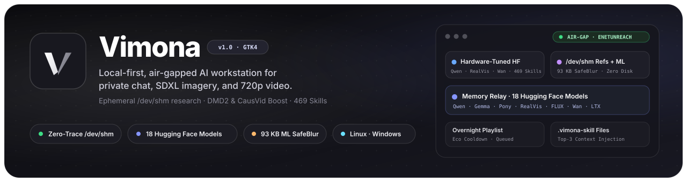
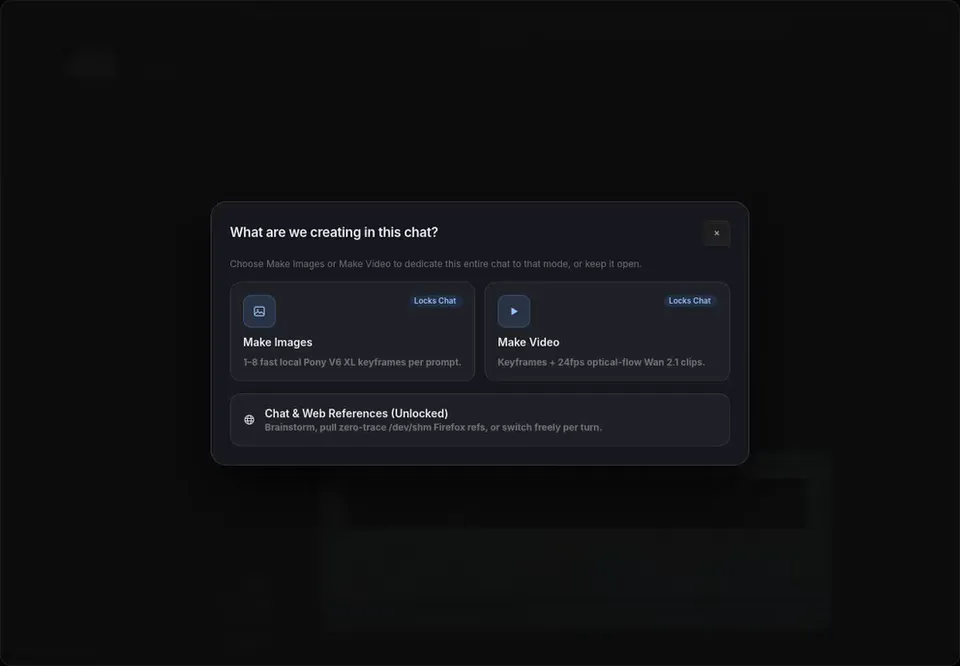
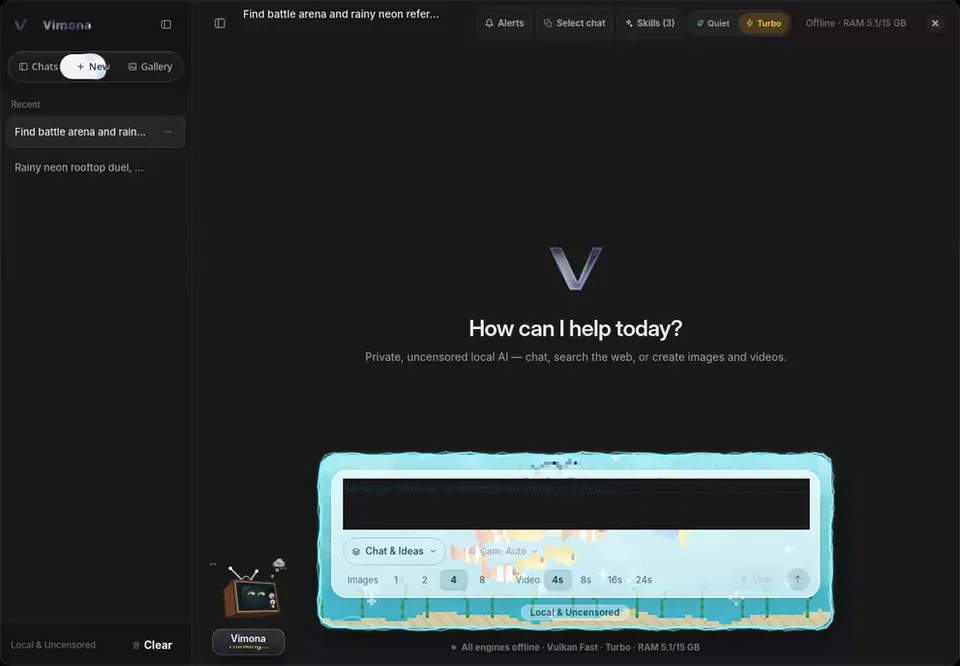
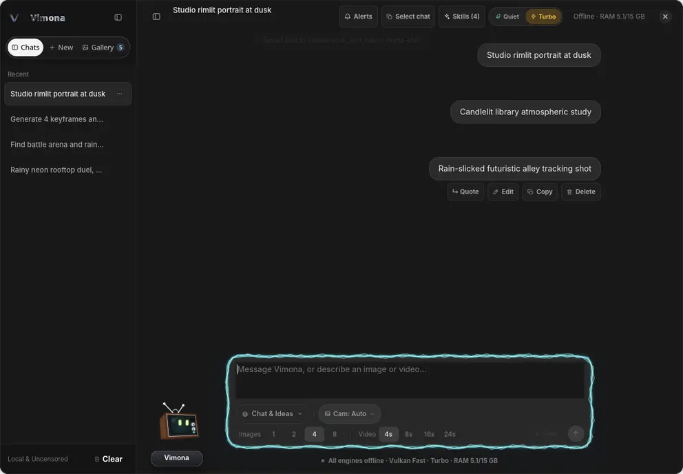

<div align="center">

<picture>
  <source media="(prefers-color-scheme: dark)" srcset="assets/brand/vimona-hero-dark.svg">
  <source media="(prefers-color-scheme: light)" srcset="assets/brand/vimona-hero-light.svg">
  
</picture>

<br/><br/>

[](pyproject.toml)
[](vimona/window.py)
[](https://github.com/comfyanonymous/ComfyUI)
[](installers/build_linux_standalone.sh)
[](.github/workflows/build-windows.yml)
[](LICENSE)

<p>
  <a href="#featured-demo-comfyui--wan-21-720p-video"><strong>720p Video Demo</strong></a> ·
  <a href="#workspace-tour"><strong>Workspace Tour</strong></a> ·
  <a href="#memory-relay-architecture"><strong>Architecture</strong></a> ·
  <a href="#installation"><strong>Linux & Windows Install</strong></a> ·
  <a href="#credits--acknowledgments"><strong>Credits</strong></a>
</p>

</div>

**Vimona** is a local desktop workstation for unified-memory machines (`16 GB` RAM / `8 GB` iGPU) that puts uncensored chat, ephemeral RAM-only web research, `Pony V6 XL` image rendering, and `Wan 2.1 VACE` `720p` video synthesis behind a native **GTK4 + Libadwaita** UI.

Instead of crushing shared RAM by holding multiple models live, Vimona swaps them sequentially: chat models shut down completely (`0.0 GB`) before diffusion boots inside a network-isolated Linux namespace (`unshare -r -n` + `AF_UNIX` bridge), while any browser lookup runs inside a disposable `/dev/shm` Firefox profile wiped immediately after extraction.

---

## Key Capabilities

<table>
  <tr>
    <td width="50%" valign="top">
      <h3>🔒 Air-Gapped Diffusion Relay</h3>
      <code>sd-server</code> and <code>ComfyUI</code> run inside <code>unshare -r -n</code> with zero WAN/LAN/DNS interfaces (<code>ENETUNREACH</code>), bridged strictly over an isolated <code>AF_UNIX</code> socket in <code>/dev/shm</code>.
    </td>
    <td width="50%" valign="top">
      <h3>🎬 720p Wan 2.1 + Pony V6 XL</h3>
      Generates crisp SDXL anchors via Vulkan (<code>--vae-tiling</code> disabled), animates motion with <code>Wan 2.1 VACE 1.3B + CausVid LoRA</code> (<code>6</code> steps), and finishes to <code>1280×720</code> at <code>24 fps</code>.
    </td>
  </tr>
  <tr>
    <td width="50%" valign="top">
      <h3>🧠 93 KB SafeBlur ML Gate</h3>
      Pure NumPy dual text + vision logistic model (<code>vimona/safety_ml.py</code>) scores prompts and video/image frames offline in milliseconds—staying unblurred for normal photography and cinema.
    </td>
    <td width="50%" valign="top">
      <h3>⚡ Overnight Queue & Thermal Eco</h3>
      Batch multi-prompt image/video jobs cleanly with Auto-Clean RAM sweeps, plus a toggleable <strong>Quiet / Eco Mode</strong> (<code>50%</code> CPU threads, <code>nice/ionice</code>, <code>5–10s</code> cooldowns).
    </td>
  </tr>
  <tr>
    <td width="50%" valign="top">
      <h3>🧩 469 Expert Domain, Prompt, Photo &amp; Video Skills</h3>
      Covers <code>Image</code> (<code>137</code> Pony/SDXL skills), <code>Video</code> (<code>124</code> Wan/ComfyUI skills), <code>Prompt Engineering</code> (<code>50</code>), <code>Context Engineering</code> (<code>50</code>), <code>Lighting</code>, <code>Camera</code>, <code>Engineering</code>, <code>Writing &amp; Reasoning</code>, &amp; <code>Web Research</code>.
    </td>
    <td width="50%" valign="top">
      <h3>🗂️ Runtime Context Engineering</h3>
      Budget-aware context assembly pins active <code>[Previous Visual Prompt Spec]</code> and <code>[Zero-Trace Web Research]</code> anchors while compacting old turns cleanly inside the <code>4096</code>-token window.
    </td>
  </tr>
</table>

---

## Featured Demo: ComfyUI + Wan 2.1 720p Video

Captured live from the GTK4 workspace (generation wait cut cleanly between handoff stages and finished clip) animating an alpine dawn anchor into `1280×720` `24 fps` footage (`temporal consistency: 0.999`):

<div align="center">



<br/>

[Watch full-resolution MP4](assets/demos/07-comfyui-video-making.mp4) · **Anchor:** Alpine Dawn Ridge (`Pony V6 XL` full-VAE) · **Video Graph:** `Wan 2.1 VACE 1.3B` + `CausVid LoRA (0.45)` · **Output:** `1280×720 @ 24 fps`

</div>

<details>
<summary>Inspect the ComfyUI Graph & DSLR Finish Parameters</summary>

| Stage | Configuration | Purpose |
| :--- | :--- | :--- |
| **Namespace Lock** | `unshare -r -n` + `/dev/shm/*.sock` | Drops all external interfaces; `127.0.0.1` bridged only via `AF_UNIX` |
| **Text Encoder** | `umt5_xxl_fp8` pinned to CPU | Frees GPU/unified VRAM budget for `Wan 2.1` UNet latents |
| **Diffusion Core** | `wan2.1_vace_1.3B_fp16` + `CausVid T2V` (`0.45`) | `640×368 @ 10 fps`, `uni_pc`, `6` steps (`shift=5.5`, `cfg=1.1`) |
| **DSLR Finish** | `ffmpeg` `lanczos` + `unsharp=5:5:0.75` + `eq` | Crisp `1280×720` `24 fps` (`6500k` H.264) verified by histogram check (`0.999`) |

</details>

---

## Workspace Tour

<table>
  <tr>
    <td width="50%" align="center">
      <strong>Mode Lock &amp; Structured Thinking</strong><br/>
      <sub>Studio chat, Image, or Video mode with transparent step reasoning</sub><br/><br/>
      <br/>
      <sub><a href="assets/demos/01-studio-modes-thinking.mp4">MP4 Recording</a></sub>
    </td>
    <td width="50%" align="center">
      <strong>Zero-Trace <code>/dev/shm</code> Research</strong><br/>
      <sub>SlideCommit permission gate, RAM-only Firefox pull, instant wipe</sub><br/><br/>
      
      <br/><sub><a href="assets/demos/02-ephemeral-research-lightbox.mp4">MP4 Recording</a></sub>
    </td>
  </tr>
  <tr>
    <td width="50%" align="center">
      <strong>Memory Relay &amp; Selective SafeBlur</strong><br/>
      <sub>LLM stops to 0.0 GB; crisp gallery renders unblur selectively via ML</sub><br/><br/>
      <br/>
      <sub><a href="assets/demos/03-media-relay-gallery-safeblur.mp4">MP4 Recording</a></sub>
    </td>
    <td width="50%" align="center">
      <strong>Overnight Render Playlist</strong><br/>
      <sub>Queue mixed image & video prompts with Auto-Clean RAM sweeps</sub><br/><br/>
      <br/>
      <sub><a href="assets/demos/04-overnight-render-playlist.mp4">MP4 Recording</a></sub>
    </td>
  </tr>
  <tr>
    <td width="50%" align="center">
      <strong><code>.vimona-skill</code> Manager &amp; Router</strong><br/>
      <sub>Toggle, import, or author skills; top 2–3 injected per turn</sub><br/><br/>
      <br/>
      <sub><a href="assets/demos/05-skills-manager.mp4">MP4 Recording</a></sub>
    </td>
    <td width="50%" align="center">
      <strong>Quiet / Eco Mode &amp; Protected RAM Monitor</strong><br/>
      <sub>Throttle threads + cooldowns and inspect/close heavy apps safely</sub><br/><br/>
      <br/>
      <sub><a href="assets/demos/06-eco-turbo-ram-monitor.mp4">MP4 Recording</a></sub>
    </td>
  </tr>
</table>

<details>
<summary>High-Resolution UI Snapshots (Render Playlist Dock &amp; Skills Manager)</summary>

<br/>

<table>
  <tr>
    <td width="50%" align="center">
      <br/>
      <sub>Sequential Render Playlist + Quiet/Eco mode active banner</sub>
    </td>
    <td width="50%" align="center">
      <br/>
      <sub>Portable <code>.vimona-skill</code> Manager with trigger-matched activation</sub>
    </td>
  </tr>
</table>

</details>

---

## Memory Relay Architecture

<div align="center">

<picture>
  <source media="(prefers-color-scheme: dark)" srcset="assets/brand/vimona-pipeline-dark.svg">
  <source media="(prefers-color-scheme: light)" srcset="assets/brand/vimona-pipeline-light.svg">
  
</picture>

</div>

### How Security & Isolation Work Together

1. **Explicit Research Gate (`SlideCommitWidget`)** — External web fetches never happen implicitly. Live page/reference lookups spawn Firefox inside `/dev/shm/vimona_ephem_*` only after you drag-confirm, pull references strictly into memory, and run `scorched_earth_wipe()` before any diffusion process launches.
2. **Kernel Namespace Lock (`vimona/airgap.py`)** — Diffusion engines run inside `unshare -r -n` on Linux with zero network devices aside from isolated `lo`. Vimona bridges HTTP IPC exclusively through a host-bound `AF_UNIX` socket file.
3. **Volatile Session Vault (`vimona/storage.py`)** — Intermediate keyframe/video artifacts remain inside volatile session directories (`$TMPDIR`) until you explicitly click **Export / Save to Gallery**.
4. **Compact 93 KB ML SafeBlur (`vimona/safety_ml.py`)** — A lightweight NumPy logistic regression model trained directly on visual color/edge/contrast features (`22` image features) and hashed n-gram text features (`512` dims, weights in `safety_ml_weights.npz`). Sensitive hits get a frosted translucent glass pill (`rgba(14,14,20,0.42)`) toggleable on demand; normal scenic or action renders stay untouched.

---

## Installation

### 🐧 Linux Standalone App & Installer (Fedora / Ubuntu / Debian / Arch)

**Option 1 — Build or launch the standalone Linux app:**

```bash
chmod +x installers/build_linux_standalone.sh
./installers/build_linux_standalone.sh
./dist/Vimona-Linux-x86_64.run
```

This packages a self-contained native ELF stub (`dist/Vimona.AppDir/usr/bin/vimona`), a portable archive (`dist/Vimona-Linux-x86_64.tar.gz`), and a single-file clickable executable (`dist/Vimona-Linux-x86_64.run`):

```bash
./dist/Vimona-Linux-x86_64.run --check           # Verify bundled app + GTK4 runtime
./dist/Vimona-Linux-x86_64.run --install-desktop # Pin standalone app to your app menu
./dist/Vimona-Linux-x86_64.run --extract ./app   # Unpack portable Vimona.AppDir
```

> Pass `--pyinstaller` on Linux (or run the [`Build Standalone Linux App`](.github/workflows/build-linux-standalone.yml) GitHub Actions workflow) to produce a frozen single-file ELF binary (`dist/Vimona-Linux-x86_64`) and `dist/Vimona-x86_64.AppImage`.

**Option 2 — System installer (installs OS packages + desktop integration):**

```bash
chmod +x installers/install-linux.sh
./installers/install-linux.sh
vimona
```

<details>
<summary>Linux Installer Flags &amp; Direct Launch</summary>

```bash
# Register launcher & .desktop icon without touching system packages
./installers/install-linux.sh --skip-deps

# Uninstall launcher, desktop entry, and app files cleanly
./installers/install-linux.sh --uninstall

# Or launch directly from the cloned repo without installing
./launch-vimona.sh
```

</details>

---

### 🪟 Windows 10 / 11 (`.exe` Installer & Standalone Build)

Vimona includes cross-platform process/UID guards (`win32` compatible) alongside native Windows packaging scripts and an automated GitHub Actions `.exe` workflow:

| Artifact / Script | Purpose | Target |
| :--- | :--- | :--- |
| [`.github/workflows/build-windows.yml`](.github/workflows/build-windows.yml) | Automated CI build uploading `Vimona.exe` & `Vimona-Setup.exe` artifacts | Windows x64 |
| [`installers/install-windows.ps1`](installers/install-windows.ps1) | Installs MSYS2 UCRT64 GTK4 + Libadwaita runtime & creates Start Menu / Desktop shortcuts | Windows 10/11 |
| [`installers/build_windows_exe.ps1`](installers/build_windows_exe.ps1) | Packages standalone `dist\Vimona\Vimona.exe` (or `-OneFile` `dist\Vimona.exe`) via PyInstaller | Developers / CI |
| [`installers/vimona-setup.iss`](installers/vimona-setup.iss) | Inno Setup script to compile `Vimona-Setup.exe` wizard with `assets/vimona.ico` | Installer Wizard |

**Quick Windows install via PowerShell:**

```powershell
Set-ExecutionPolicy -Scope Process Bypass
.\installers\install-windows.ps1
```

**Build standalone `Vimona.exe` & `Vimona-Setup.exe` locally on Windows:**

```powershell
# Builds dist\Vimona\Vimona.exe + dist\Vimona-Setup.exe (when Inno Setup 6 is installed)
.\installers\build_windows_exe.ps1

# Or build a single portable binary: dist\Vimona.exe
.\installers\build_windows_exe.ps1 -OneFile
```

> **Note:** On Linux hosts without MinGW/Wine/PyInstaller-Windows, run the GitHub Actions workflow (`Build Windows .exe & Verify Linux`) on GitHub to download ready-to-run `Vimona.exe` and `Vimona-Setup.exe` artifacts cleanly.

---

### 🤖 Local Model Paths

Vimona expects local inference engines and checkpoints alongside its workspace paths:

- **Chat / Router LLM (`llama-server`)** — Vulkan `GGUF` server (`http://127.0.0.1:8080` / managed by `MemoryRelayManager`)
- **SDXL Still Images (`sd-server`)** — `Pony V6 XL` (`sd-server` Vulkan without `--vae-tiling`)
- **Video (`ComfyUI`)** — `~/comfyui` with `wan2.1_vace_1.3B_fp16.safetensors`, `umt5_xxl_fp8_e4m3fn_scaled.safetensors`, and `Wan21_CausVid_bidirect2_T2V_1_3B_lora_rank32.safetensors`

---

## Keyboard Shortcuts

| Shortcut | Action |
| :--- | :--- |
| `Ctrl` + `N` | Start a new chat (opens mode picker) |
| `Ctrl` + `B` / `Ctrl` + `\` | Toggle the conversation sidebar |
| `Ctrl` + `K` | Focus the message / prompt composer |
| `Ctrl` + `Shift` + `A` | Open whole-chat multi-turn selector |
| `Enter` / `Shift` + `Enter` | Send prompt / Insert newline |
| `Space` | Play / Pause active video in Lightbox |
| `←` / `→` (or `,` / `.`) | Navigate media items in Lightbox |
| `+` / `-` / `0` / `I` | Zoom in / out / reset view / toggle Lightbox inspector drawer |
| `Esc` | Close active overlay, Lightbox, selector, or modal |

---

## Project Layout

```text
vimona/
├── run_vimona.py                 # Entrypoint launching Adw.Application
├── launch-vimona.sh              # Linux wrapper launching run_vimona.py
├── dev.vimona.Desktop.{desktop,svg}
├── installers/
│   ├── build_linux_standalone.sh # Standalone AppDir, ELF stub & .run builder
│   ├── install-linux.sh          # Fedora / Ubuntu / Debian / Arch installer
│   ├── install-windows.ps1       # Windows 10/11 MSYS2 GTK4 setup & shortcuts
│   ├── build_windows_exe.ps1     # PyInstaller Vimona.exe + Inno Setup builder
│   └── vimona-setup.iss          # Windows Setup Wizard definition
├── .github/workflows/
│   ├── build-linux-standalone.yml# CI build for .run, AppImage & frozen Linux ELF
│   └── build-windows.yml         # CI build for Vimona.exe & Linux checks
├── assets/
│   ├── vimona.ico                # Multi-size Windows icon (16..256px)
│   ├── brand/                    # Light & dark hero + pipeline SVGs
│   ├── demos/                    # 01..07 animated WebP & MP4 showcases
│   └── *.png                     # High-res UI workspace snapshots
└── vimona/
    ├── app.py & window.py        # GTK4 + Libadwaita window & Lightbox UI
    ├── controller.py             # Turn routing, SlideCommit, media handoff
    ├── memory_relay.py           # Mutual-exclusion RAM swap between LLM & ComfyUI
    ├── airgap.py                 # unshare -r -n namespace + AF_UNIX bridge
    ├── workflows.py              # Wan 2.1 VACE 1.3B + CausVid ComfyUI graph
    ├── fast_media_engine.py      # Pony V6 XL runner + 720p DSLR ffmpeg finish
    ├── safety_ml.py              # 93 KB offline NumPy text+vision SafeBlur ML
    ├── search_worker.py          # Ephemeral /dev/shm headless Firefox scraper
    ├── playlist.py               # Sequential overnight render queue
    ├── skills_loader.py          # .vimona-skill CRUD & top-3 router
    ├── perf_profile.py           # Quiet/Eco vs Turbo thermal throttling
    └── ram_manager.py            # Protected PID /proc RAM inspector
```

---

## Credits & Acknowledgments

Vimona's local execution pipeline relies directly on remarkable open-source engines and community models:

- **[ComfyUI (`comfyanonymous/ComfyUI` & Comfy-Org)](https://github.com/comfyanonymous/ComfyUI)** — Powers Vimona's node-based air-gapped video and diffusion backend (`WanVaceToVideo`, `ModelSamplingSD3`, `--lowvram` memory offloading, UMT5 CPU execution, and `VHS_VideoCombine` via ComfyUI-VideoHelperSuite). Without ComfyUI's graph API and unified-RAM management, `Wan 2.1` video generation on `16 GB` iGPU hardware would not be possible.
- **[llama.cpp (`ggml-org/llama.cpp`)](https://github.com/ggml-org/llama.cpp)** — High-speed Vulkan `GGUF` inference server for local chat and prompt routing.
- **[stable-diffusion.cpp (`leejet/stable-diffusion.cpp`)](https://github.com/leejet/stable-diffusion.cpp)** — Fast Vulkan SDXL rendering backend (`sd-server`) driving `Pony V6 XL` keyframe generation.
- **[Wan 2.1 (`Wan-Video/Wan2.1`)](https://github.com/Wan-Video/Wan2.1)** & **[CausVid](https://github.com/tianweiy/CausVid)** — Diffusion video synthesis and 6-step distilled LoRA acceleration.
- **[GTK4](https://www.gtk.org/) & [Libadwaita](https://gnome.pages.gitlab.gnome.org/libadwaita/)** — Native hardware-accelerated Linux/MSYS2 desktop interface.

<div align="center">
  <br/>
  <sub>Powered by <strong><a href="https://github.com/comfyanonymous/ComfyUI">ComfyUI</a></strong>, GTK4, Libadwaita, llama.cpp Vulkan, Pony V6 XL, and Wan 2.1 · <a href="LICENSE">MIT License</a></sub>
</div>
