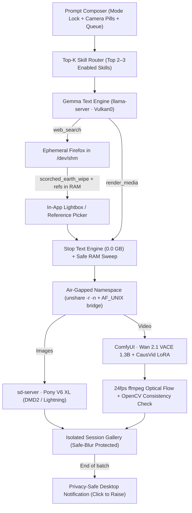

<div align="center">


# Vimona

**Local offline AI workspace for Linux — chat, zero-trace web reference pulling, Pony V6 XL images, and Wan 2.1 video orchestrated inside 16 GB unified RAM.**

<p>
  
  
  
  
  
</p>

<p>
  <a href="#preview">Preview</a> •
  <a href="#why-vimona">Why Vimona</a> •
  <a href="#architecture">Architecture</a> •
  <a href="#overnight-render-playlist">Render Playlist</a> •
  <a href="#skills-manager--vimona-skill">Skills Manager</a> •
  <a href="#quiet--eco-vs-turbo-mode">Eco vs Turbo</a> •
  <a href="#quick-start">Quick Start</a> •
  <a href="#shortcuts">Shortcuts</a>
</p>

</div>

---

## Preview

<table>
  <tr>
    <td width="50%" align="center">
      
      <br />
      <sub><b>Overnight Render Playlist + Quiet / Eco Mode</b> — Ordered job cards, live RAM telemetry, auto-clean toggle, and thermal cooldown status.</sub>
    </td>
    <td width="50%" align="center">
      
      <br />
      <sub><b>Modular Skills Manager</b> — Search, category filters, one-click switches, custom pack builder, and <code>.vimona-skill</code> import/export.</sub>
    </td>
  </tr>
</table>

---

## Why Vimona

Running an uncensored text model, an SDXL checkpoint, and a video diffusion model at the same time on a 16 GB shared-memory laptop causes swap thrashing and OOM kills. Most local UIs leave every backend loaded and hope the OS survives.

Vimona treats memory like a baton pass:

<table>
  <tr>
    <td width="50%" valign="top">
      <h4>1. Zero-Overlap 16 GB RAM Relay</h4>
      <p>Gemma (<code>llama-server</code> on <code>Vulkan0</code>) plans prompts and tool calls, then shuts down completely to <code>0.0 GB</code> before <code>sd-server</code> or ComfyUI boots. Once rendering finishes, the text engine reloads cleanly.</p>
    </td>
    <td width="50%" valign="top">
      <h4>2. Kernel Air-Gapped Inference</h4>
      <p>Image and video backends run inside isolated Linux user + network namespaces (<code>unshare -r -n</code>) with zero WAN/LAN/DNS access, talking back to Vimona only through a private <code>AF_UNIX</code> socket in <code>/dev/shm</code>.</p>
    </td>
  </tr>
  <tr>
    <td width="50%" valign="top">
      <h4>3. Volatile <code>/dev/shm</code> Web References</h4>
      <p>When a turn needs real-world visual references, headless Firefox spins up inside RAM under <code>/dev/shm</code>, extracts results and candidate images in memory, and gets wiped with <code>scorched_earth_wipe()</code> before rendering starts.</p>
    </td>
    <td width="50%" valign="top">
      <h4>4. Privacy & Safe-Blur by Default</h4>
      <p>Sensitive prompts, live queries, thumbnails, and desktop notifications stay obfuscated until explicitly unlocked. Renders stay inside Vimona's isolated session gallery unless you save them manually.</p>
    </td>
  </tr>
</table>

---

## Architecture

Every turn flows through [controller.py](vimona/controller.py) and hands memory exclusively to one engine at a time:



<details>
<summary><b>Inspect actual hardware flags, model relay specs, and runtime paths</b></summary>

| Engine | Binary / Entrypoint | Flags & Isolation | Output Path |
| :--- | :--- | :--- | :--- |
| **Text / Planning** | `~/llama.cpp/build/bin/llama-server` | `--device Vulkan0 --flash-attn on --load-mode none --ctx-size 4096 --n-gpu-layers 99 --reasoning-budget 96` (`--host 127.0.0.1`) | Streaming SSE + `<details>` reasoning trace |
| **Fast Image Backend** | `~/stable-diffusion.cpp/build/bin/sd-server` | `pony-diffusion-v6-xl-Q8_0.gguf` + `sdxl_vae.safetensors` (`--force-sdxl-vae-conv-scale`) + DMD2 / Lightning LoRA inside `unshare -r -n` | Volatile session dir (`/tmp/vimona-session-media-*`) |
| **Video Backend** | `~/comfyui/venv/bin/python ~/comfyui/main.py` | `--lowvram --cpu-vae --cache-none --offline --disable-partner-nodes`, `HSA_OVERRIDE_GFX_VERSION=11.0.0`, 4s Wan 2.1 VACE sliding windows + CausVid LoRA inside `unshare -r -n` | 24fps interpolated `.mp4` in session gallery |
| **Web Research** | Playwright Firefox worker (`search_worker.py`) | Profile created purely in `/dev/shm/vimona_ephem_*`; `-allow-downgrade`, `kp=-2`, destroyed immediately after fetch | In-memory refs + inline clickable `[1]` citations |

</details>

---

## Overnight Render Playlist

Queue mixed image, video, and research prompts and walk away. Instead of flooding memory or spamming your desktop with 12 popups at 3 AM, Vimona executes the playlist deterministically:

1. **Ordered Job Cards** — Shows prompt snippet, Mode (`Image` / `Video`), target Model (`Pony V6 XL` / `Wan 2.1`), live status pill (`Queued` → `Air-Gapped Rendering` → `Consistency Check` → `Cooldown` → `Done`), and live progress bar + RAM telemetry.
2. **Queue Controls** — Reorder queued cards (`↑` / `↓`), cancel individual jobs (`×`), toggle **`Auto-Clean RAM: On/Off`**, and switch **`Batch Alert: Single / Per job`**.
3. **Between-Job Memory Hygiene** — Before each queued job starts, `prepare_between_job_hygiene()` forces the LLM offline (`0.0 GB`) and invokes the protected RAM sweeper (`ram_manager.py`) if memory pressure is high (never touching protected OS or active engine PIDs).
4. **Automatic Video Verification** — Rendered video clips pass through `verify_video_temporal_consistency()` (OpenCV frame histogram correlation) before marking complete.
5. **Single Privacy-Safe Batch Alert** — When `Batch Alert: Single` is active, per-job alerts are suppressed and a single native notification fires on completion (e.g., `Batch Complete · 5/5 renders saved to In-App Gallery · Total time: 4m 12s`), avoiding unblurred thumbnail leakage.

---

## Skills Manager & `.vimona-skill`

Vimona routes system instructions and ComfyUI/sampler patches through modular skills instead of stuffing every prompt rule into Gemma's 4096-token context window.

- **Top-K Dynamic Injection** — `select_active_skills()` indexes only `enabled: true` packs, scores triggers against your prompt and active chat mode, and injects at most the **top 2–3 matching skills**.
- **Sampler & Override Patches** — Enabled matching skills can append to `negative_prompt` and patch ComfyUI / `sd-server` parameters (`cfg`, `sampler`, `flow_shift`, `booster`).
- **Dark Mode UI** — Click **`Skills (N)`** in the header to search installed skills, filter by category (`Image`, `Video`, `Web Research`, `Lighting`, `Camera`), toggle packs on/off, create custom skills in-app, drag-and-drop or pick `.vimona-skill` files to import, and export packs cleanly for sharing.

<details>
<summary><b>Interactive <code>.vimona-skill</code> schema & sample pack (JSON or YAML)</b></summary>

Save this as `neon-rain.vimona-skill` and drop it onto the **Skills Manager** modal (or click **Import .vimona-skill**):

```json
{
  "id": "neon-rain-rimlight",
  "name": "Neon Rain Rimlight",
  "version": "1.2.0",
  "author": "vimona-user",
  "category": "Lighting",
  "trigger_keywords": ["neon", "rain", "wet street", "cyberpunk", "night"],
  "system_instructions": "Use high-contrast cyan and magenta rim lighting across wet asphalt reflections, backlit rain streaks, and deep shadow falloff.",
  "negative_prompt_patch": "flat lighting, overcast haze, washed out contrast",
  "comfyui_node_overrides": {
    "cfg": 6.0,
    "sampler": "euler_ancestral",
    "flow_shift": 7.5,
    "booster": false
  }
}
```

User packs live in `~/.local/share/vimona/skills/` and toggle states persist in `~/.local/share/vimona/skills_state.json`.

</details>

---

## Quiet / Eco vs. Turbo Mode

Use the header pill (**`Quiet`** leaf vs. **`Turbo`** bolt) to switch thermal behavior live without restarting the app. The footer telemetry strip reflects the active profile immediately.

| Setting | Quiet / Eco Mode | Turbo Mode |
| :--- | :--- | :--- |
| **Footer Telemetry** | `Vulkan Eco · Thermal Cap` | `Vulkan Fast · Turbo` |
| **Worker CPU Threads** | Capped at 50% of cores (`OMP_NUM_THREADS`, OpenCV, FFmpeg `-threads`) | 100% of available cores |
| **Process Priority** | Linux `ionice -c 3` + `nice -n 12` (Windows: `BELOW_NORMAL_PRIORITY_CLASS`) | Standard OS scheduling priority |
| **Batch Queue Pacing** | `7.0s` thermal cooldown countdown between queued renders | Back-to-back immediate dispatch (`0.0s`) |
| **Auxiliary Pipelines** | Throttled optical-flow interpolation & consistency checks to curb fan ramp | Full speed RIFE / `minterpolate` & DMD2/CausVid booster passes |

---

## Privacy, Storage & UX Details

- **Centered New-Chat Mode Picker** — Opening a new chat (`Ctrl+N`) presents a centered overlay to lock the session to **Make Images**, **Make Video**, or unlocked **Chat & Web References**.
- **Follow-Up Prompt Continuity** — Edits like `"change lighting to sunset"` or `"make it low angle"` merge prior established scene anchors with your update rather than drifting to a blank canvas.
- **In-App RAM Reference Lightbox** — Clicking any fetched web image or rendered clip opens a full in-app inspector with zoom (`+`/`-`/`0`), panning, metadata drawer (`I`), and OpenCV frame-by-frame video scrubbing without writing browser history.
- **Click-to-Raise Notifications** — Desktop notifications route back through DBus (`app.focus-chat`) / `--wait` action so clicking the toast unminimizes and focuses the exact chat.

<details>
<summary><b>Where Vimona stores files (and what it deliberately never saves)</b></summary>

| Path | Contents | Behavior |
| :--- | :--- | :--- |
| `~/.local/share/vimona/chats.json` | Text conversation history & prompt metadata | Saved locally after turns; never includes bulk media |
| `~/.local/share/vimona/skills/*.vimona-skill` | Custom & imported user skill packs | JSON packs managed via Skills Manager |
| `~/.local/share/vimona/prefs.json` | Hardware profile (`eco` / `turbo`) | Applied live on toggle and restored at launch |
| `/dev/shm/vimona_ephem_*` | Ephemeral Playwright Firefox profile | Wiped via `scorched_earth_wipe()` right after fetch |
| `/tmp/vimona-session-media-*` | Session-only generated images & MP4 clips | Isolated from `~/Pictures` & `~/Downloads`; cleaned on exit |

</details>

---

## Quick Start

### Launch the Desktop App

```bash
./launch-vimona.sh
```

Or launch directly with Python:

```bash
python3 run_vimona.py
```

Desktop menu integration is provided by `dev.vimona.Desktop.desktop` (`~/.local/bin/vimona` invokes `launch-vimona.sh`).

### Verify Build & Modules

```bash
# Syntax check across all modules
python3 -m py_compile vimona/*.py run_vimona.py
```

<details>
<summary><b>Explore repository layout (32 files inside <code>vimona/</code> across UI, airgap, memory relay, skills, and shaders)</b></summary>

```text
vimona/
├── __init__.py            # App metadata (dev.vimona.Desktop, v1.0.0)
├── app.py                 # Adw.Application lifecycle, dark CSS loader, DBus notification actions
├── window.py              # Main GTK4 workspace, header Quiet/Turbo pill, Render Playlist dispatch
├── controller.py          # Turn orchestration, follow-up continuity, between-job RAM hygiene
├── memory_relay.py        # Exclusive 16 GB RAM relay across llama-server, sd-server, and ComfyUI
├── airgap.py              # Kernel unshare -r -n isolation, AF_UNIX /dev/shm bridge, scorched-earth wipe
├── fast_media_engine.py   # Vulkan Pony sd-server streamer, 24fps optical-flow, OpenCV consistency check
├── workflows.py           # Pony V6 XL + Wan 2.1 VACE 1.3B workflow graphs & skill override hooks
├── search_worker.py       # Ephemeral /dev/shm Playwright Firefox scraper + RAM image analysis
├── skills_loader.py       # .vimona-skill schema, YAML/JSON parser, Top-3 enabled-only prompt router
├── skills_manager.py      # Dark-mode Skills Manager overlay (search, filters, create, drag-drop import/export)
├── perf_profile.py        # Quiet/Eco vs Turbo thread caps, nice/ionice wrapping, cooldown timer
├── ram_manager.py         # Protected PID tracking + non-intrusive InstalledAppsRamWindow sweeper
├── safety_patterns.py     # Sensitive keyword pattern detector for prompts, queries, and alerts
├── safety_blur.py         # GPU Safe-Blur wrapper with click-to-reveal lock and slide-to-commit confirm
├── media.py               # OpenCV VideoFrameDecoder + MP4 probe helpers
├── storage.py             # chats.json persistence + ephemeral session staging & exit cleanup
├── models.py              # Dataclasses (ChatSession, RenderPlaylistJob, PromptSpec, VideoClipSpec, etc.)
├── widgets.py             # Floating composer, Render Playlist drawer, camera chips, gallery, Lightbox
├── tokens.py              # Matte-graphite design tokens & 46 KB GTK4 CSS stylesheet
├── icons.py               # Inline Cairo SVG vector icon primitives
├── aquarium.py            # Idle floating composer ambient canvas
├── crt_warp.py            # CRT distortion overlay renderer
├── electric_border.py     # Animated border highlight for active generation/playlist focus
├── gooey_nav.py           # Sidebar navigation pill indicator
├── metallic_paint.py      # Sculpted V brand shimmer shader
├── slide_commit.py        # Slide-to-confirm permission & unblur widget
├── text_loop.py           # Animated placeholder/status ticker
├── tv_mascot.py           # Reactive CRT mascot indicator (idle, thinking, done)
└── skills/                # Core built-in prompt protocols (.md)
    ├── firefox_research.md
    ├── pony_choreography.md
    └── ram_relay.md
```

</details>

---

## Shortcuts

| Keys | Action |
| :--- | :--- |
| `Ctrl` + `N` | New chat (opens centered Image / Video / Open mode selector) |
| `Ctrl` + `K` | Focus prompt composer |
| `Ctrl` + `B` or `Ctrl` + `\` | Toggle conversation sidebar |
| `Ctrl` + `Shift` + `A` | Open full selectable & quotable conversation viewer |
| `Esc` | Close active overlay (Skills Manager, Lightbox, Mode Picker, Chat Selector) |
| `Left` / `Right` or `,` / `.` | Step between items inside Lightbox Inspector |
| `Space` | Play / pause video inside Lightbox |
| `+` / `-` / `0` | Zoom in, zoom out, or reset view in Lightbox |
| `I` | Toggle Lightbox metadata drawer |
