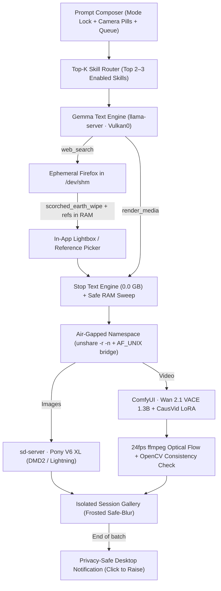

<div align="center">


# Vimona

**Local offline AI workspace for Linux — chat, zero-trace `/dev/shm` web reference pulling, Pony V6 XL images, and Wan 2.1 video orchestrated inside 16 GB unified RAM.**

<p>
  
  
  
  
  
</p>

<p>
  <a href="#video-walkthroughs">Video Walkthroughs</a> •
  <a href="#why-vimona">Why Vimona</a> •
  <a href="#architecture">Architecture</a> •
  <a href="#overnight-render-playlist">Render Playlist</a> •
  <a href="#skills-manager--vimona-skill">Skills Manager</a> •
  <a href="#quiet--eco-vs-turbo-mode">Eco vs Turbo</a> •
  <a href="#quick-start">Quick Start</a> •
  <a href="#shortcuts">Shortcuts</a>
</p>

</div>

---

## Video Walkthroughs

Every recording below was captured directly from the live GTK4 workspace (generation pauses cut cleanly so playback jumps straight from handoff to the finished local `Pony V6 XL` / `Wan 2.1` output).

<table>
  <tr>
    <td width="50%" align="center">
      
      <br />
      <b>1. Studio Modes, Thinking Trace & Camera Chips</b>
      <br />
      <sub>Centered new-chat mode lock, streamed reasoning accordion, prompt tag breakdown, quick camera pills, and full conversation selector. (<a href="assets/demos/01-studio-modes-thinking.mp4">MP4</a>)</sub>
    </td>
    <td width="50%" align="center">
      
      <br />
      <b>2. <code>/dev/shm</code> Research, Safe-Blur & RAM Lightbox</b>
      <br />
      <sub>Slide-to-allow sandbox prompt, inline citations, frosted Gaussian Safe-Blur strictly on sensitive matches, and zoomed in-app Lightbox inspection. (<a href="assets/demos/02-ephemeral-research-lightbox.mp4">MP4</a>)</sub>
    </td>
  </tr>
  <tr>
    <td width="50%" align="center">
      
      <br />
      <b>3. 16 GB RAM Relay, Keyframes, Video & Gallery</b>
      <br />
      <sub>Gemma unloads to <code>0.0 GB</code>, air-gapped <code>Pony V6 XL</code> renders stream into the 2×2 grid alongside 24fps playback and the isolated in-app Gallery. (<a href="assets/demos/03-media-relay-gallery-safeblur.mp4">MP4</a>)</sub>
    </td>
    <td width="50%" align="center">
      
      <br />
      <b>4. Overnight Render Playlist & Hygiene</b>
      <br />
      <sub>Ordered image/video queue cards, up/down/cancel actions, <code>Auto-Clean RAM</code>, per-stage status pills, and a single privacy-safe <code>Batch Complete</code> alert. (<a href="assets/demos/04-overnight-render-playlist.mp4">MP4</a>)</sub>
    </td>
  </tr>
  <tr>
    <td width="50%" align="center">
      
      <br />
      <b>5. Modular <code>.vimona-skill</code> Manager</b>
      <br />
      <sub>Category filtering, live keyword search, custom pack builder with sampler overrides, import/export, and Top-3 enabled routing. (<a href="assets/demos/05-skills-manager.mp4">MP4</a>)</sub>
    </td>
    <td width="50%" align="center">
      
      <br />
      <b>6. Quiet / Eco vs. Turbo & RAM Monitor</b>
      <br />
      <sub>Live header profile toggle synced to footer telemetry, model readiness popover, and non-intrusive process RAM monitor. (<a href="assets/demos/06-eco-turbo-ram-monitor.mp4">MP4</a>)</sub>
    </td>
  </tr>
</table>

---

## Why Vimona

Running an uncensored LLM, an SDXL checkpoint, and a video model simultaneously on a 16 GB shared-memory laptop causes swap thrashing and OOM kills. Most local frontends leave every server running and let the kernel kill whichever process crosses the limit.

Vimona passes memory like a baton:

<table>
  <tr>
    <td width="50%" valign="top">
      <h4>1. Zero-Overlap 16 GB RAM Relay</h4>
      <p>Gemma (<code>llama-server</code> on <code>Vulkan0</code>) plans prompts and tool calls, then shuts down completely to <code>0.0 GB</code> before <code>sd-server</code> or ComfyUI boots. Once rendering finishes, the text engine reloads automatically.</p>
    </td>
    <td width="50%" valign="top">
      <h4>2. Kernel Air-Gapped Inference</h4>
      <p>Image and video backends run inside isolated Linux user + network namespaces (<code>unshare -r -n</code>) with zero WAN/LAN/DNS access, communicating with Vimona solely across a private <code>AF_UNIX</code> socket bridge in <code>/dev/shm</code>.</p>
    </td>
  </tr>
  <tr>
    <td width="50%" valign="top">
      <h4>3. Volatile <code>/dev/shm</code> Web References</h4>
      <p>When a prompt needs real-world visual references, headless Firefox runs directly inside RAM under <code>/dev/shm</code>, extracts context and images in memory, and gets destroyed via <code>scorched_earth_wipe()</code> before rendering starts.</p>
    </td>
    <td width="50%" valign="top">
      <h4>4. Dedicated Micro-ML Safe-Blur</h4>
      <p>Instead of naive keyword trips or LLM overhead, a tiny <code>93 KB</code> NumPy/OpenCV classifier (<code>safety_ml.py</code>) scores text n-grams and 28-D visual patch geometry (&lt;2 ms) so frosted Gaussian blur only triggers on genuinely explicit or graphic items, while finished renders stay isolated in Vimona's gallery.</p>
    </td>
  </tr>
</table>

---

## Architecture

Every turn routes through [controller.py](vimona/controller.py) and assigns system memory exclusively to one engine at a time:



<details>
<summary><b>Inspect actual hardware flags, model relay specs, and runtime paths</b></summary>

| Engine | Binary / Entrypoint | Flags & Isolation | Output Path |
| :--- | :--- | :--- | :--- |
| **Text / Planning** | `~/llama.cpp/build/bin/llama-server` | `--device Vulkan0 --flash-attn on --load-mode none --ctx-size 4096 --n-gpu-layers 99 --reasoning-budget 96` (`--host 127.0.0.1`) | Streaming SSE + `<details>` reasoning trace |
| **Fast Image Backend** | `~/stable-diffusion.cpp/build/bin/sd-server` | `pony-diffusion-v6-xl-Q8_0.gguf` + `sdxl_vae.safetensors` (`--force-sdxl-vae-conv-scale`) + DMD2 / Lightning LoRA inside `unshare -r -n` | Volatile session dir (`/tmp/vimona-session-media-*`) |
| **Video Backend** | `~/comfyui/venv/bin/python ~/comfyui/main.py` | `--lowvram --cpu-vae --cache-none --offline --disable-partner-nodes`, `HSA_OVERRIDE_GFX_VERSION=11.0.0`, 4s Wan 2.1 VACE sliding windows + CausVid LoRA inside `unshare -r -n` | 24fps interpolated `.mp4` in session gallery |
| **Web Research** | Playwright Firefox worker (`search_worker.py`) | Profile created purely in `/dev/shm/vimona_ephem_*`; `-allow-downgrade`, `kp=-2`, destroyed immediately after fetch | In-memory refs + inline clickable `[1]` citations |

</details>

---

## Overnight Render Playlist

Queue mixed image, video, and research prompts cleanly without overloading memory or spamming notifications:

1. **Ordered Job Cards** — Prompt snippet, Mode (`Image` / `Video` / `Research`), target Model (`Pony V6 XL` / `Wan 2.1`), live status pill (`Queued` → `Air-Gapped Rendering` → `Consistency Check` → `Cooldown` → `Done`), plus progress bar and RAM telemetry.
2. **Queue Controls** — Reorder queued jobs (`↑` / `↓`), cancel individual items (`×`), toggle **`Auto-Clean RAM: On/Off`**, and switch **`Batch Alert: Single / Per job`**.
3. **Between-Job Memory Hygiene** — Before each queued job runs, `prepare_between_job_hygiene()` ensures the Text engine is stopped (`0.0 GB`) and invokes the protected RAM sweeper (`ram_manager.py`) if memory pressure exceeds threshold.
4. **Automatic Video Verification** — Rendered video clips pass through `verify_video_temporal_consistency()` (OpenCV frame histogram correlation) before marking done.
5. **Single Privacy-Safe Batch Alert** — With `Batch Alert: Single`, per-job notifications stay muted during batch execution and one native `"Batch Complete"` notification fires when the playlist finishes (masking titles/thumbnails if any job was sensitive).

---

## Skills Manager & `.vimona-skill`

Instead of bloating Gemma's 4096-token context with every rule, Vimona loads modular skill packs dynamically:

- **Top-K Dynamic Routing** — `select_active_skills()` indexes only `enabled: true` packs, ranks trigger keywords against your prompt and chat mode, and injects only the **top 2–3 matching skills**.
- **Sampler & Override Patches** — Matching skills can append negative prompt patches and override `cfg`, `sampler`, `flow_shift`, or `booster` parameters on `sd-server` and ComfyUI Wan workflows.
- **In-App Skills Manager** — Click **`Skills (N)`** in the header to search, filter by category (`Image`, `Video`, `Web Research`, `Lighting`, `Camera`), toggle packs on/off, author custom skills, drag-and-drop `.vimona-skill` files to import, or export packs to share.

<details>
<summary><b>Interactive <code>.vimona-skill</code> schema & sample pack (JSON or YAML)</b></summary>

Save this as `neon-rain.vimona-skill` and drop it onto the **Skills Manager** modal (or click **Import .vimona-skill**):

```json
{
  "id": "neon-rain-rimlight",
  "name": "Neon Rain Rimlight",
  "version": "1.2.0",
  "author": "vimona-user",
  "category": "Lighting",
  "trigger_keywords": ["neon", "rain", "wet street", "cyberpunk", "night"],
  "system_instructions": "Use high-contrast cyan and magenta rim lighting across wet asphalt reflections, backlit rain streaks, and deep shadow falloff.",
  "negative_prompt_patch": "flat lighting, overcast haze, washed out contrast",
  "comfyui_node_overrides": {
    "cfg": 6.0,
    "sampler": "euler_ancestral",
    "flow_shift": 7.5,
    "booster": false
  }
}
```

User packs persist in `~/.local/share/vimona/skills/` and toggle states persist in `~/.local/share/vimona/skills_state.json`.

</details>

---

## Quiet / Eco vs. Turbo Mode

Switch thermal profiles live from the **`Quiet`** (leaf) / **`Turbo`** (bolt) pill in the header. Footer telemetry updates immediately.

| Setting | Quiet / Eco Mode | Turbo Mode |
| :--- | :--- | :--- |
| **Footer Telemetry** | `Vulkan Eco · Thermal Cap` | `Vulkan Fast · Turbo` |
| **Worker CPU Threads** | Capped at 50% of cores (`OMP_NUM_THREADS`, OpenCV, FFmpeg `-threads`) | 100% of available cores |
| **Process Priority** | Linux `ionice -c 3` + `nice -n 12` (Windows: `BELOW_NORMAL_PRIORITY_CLASS`) | Standard OS scheduling priority |
| **Batch Queue Pacing** | `7.0s` thermal cooldown countdown between queued renders | Back-to-back immediate dispatch (`0.0s`) |
| **Auxiliary Pipelines** | Throttled optical-flow interpolation & consistency checks to curb fan ramp | Full speed RIFE / `minterpolate` & DMD2/CausVid booster passes |

---

## Privacy, Storage & UX Details

- **Centered New-Chat Mode Picker** — `Ctrl+N` opens a centered modal to lock the session to **Make Images**, **Make Video**, or unlocked **Chat & Web References**.
- **Follow-Up Prompt Continuity** — Edits like `"change lighting to sunset"` or `"make it low angle"` merge prior established scene anchors with your update instead of drifting.
- **Click-to-Raise Notifications** — Desktop notifications wire through DBus (`app.focus-chat`) / `--wait` so clicking the toast unminimizes and focuses that conversation.

<details>
<summary><b>Where Vimona stores files (and what stays RAM-only)</b></summary>

| Path | Contents | Behavior |
| :--- | :--- | :--- |
| `~/.local/share/vimona/chats.json` | Text conversation history & prompt metadata | Saved locally after turns; never writes bulk media |
| `~/.local/share/vimona/skills/*.vimona-skill` | Custom & imported user skill packs | JSON packs managed via Skills Manager |
| `~/.local/share/vimona/prefs.json` | Hardware profile (`eco` / `turbo`) | Applied live on toggle and restored on launch |
| `/dev/shm/vimona_ephem_*` | Ephemeral Playwright Firefox profile | Wiped via `scorched_earth_wipe()` right after fetch |
| `/tmp/vimona-session-media-*` | Session-only generated images & MP4 clips | Isolated from `~/Pictures` & `~/Downloads`; cleaned on exit |

</details>

---

## Quick Start

### Launch the Desktop App

```bash
./launch-vimona.sh
```

Or run via Python directly:

```bash
python3 run_vimona.py
```

### Verify Modules

```bash
python3 -m py_compile vimona/*.py run_vimona.py
```

<details>
<summary><b>Explore repository layout (34 files inside <code>vimona/</code> across UI, airgap, memory relay, skills, SafeBlur ML, and shaders)</b></summary>

```text
vimona/
├── __init__.py            # App metadata (dev.vimona.Desktop, v1.0.0)
├── app.py                 # Adw.Application lifecycle, dark CSS loader, DBus notification actions
├── window.py              # Main GTK4 workspace, header Quiet/Turbo pill, Render Playlist dispatch
├── controller.py          # Turn orchestration, follow-up continuity, between-job RAM hygiene
├── memory_relay.py        # Exclusive 16 GB RAM relay across llama-server, sd-server, and ComfyUI
├── airgap.py              # Kernel unshare -r -n isolation, AF_UNIX /dev/shm bridge, scorched-earth wipe
├── fast_media_engine.py   # Vulkan Pony sd-server streamer, 24fps optical-flow, OpenCV consistency check
├── workflows.py           # Pony V6 XL + Wan 2.1 VACE 1.3B workflow graphs & skill override hooks
├── search_worker.py       # Ephemeral /dev/shm Playwright Firefox scraper + RAM image analysis
├── skills_loader.py       # .vimona-skill schema, YAML/JSON parser, Top-3 enabled-only prompt router
├── skills_manager.py      # Dark-mode Skills Manager overlay (search, filters, create, drag-drop import/export)
├── perf_profile.py        # Quiet/Eco vs Turbo thread caps, nice/ionice wrapping, cooldown timer
├── ram_manager.py         # Protected PID tracking + non-intrusive InstalledAppsRamWindow sweeper
├── safety_ml.py           # Compact 93 KB Micro-ML engine (Text n-gram MLP + 28-D OpenCV Vision MLP)
├── safety_ml_weights.npz  # Pretrained NumPy MLP weights for sub-2ms Safe-Blur scoring (zero LLM)
├── safety_patterns.py     # Sensitive text entry point backed by safety_ml.SafeBlurMLEngine
├── safety_blur.py         # GPU frosted Safe-Blur wrapper with click-to-reveal and slide-to-commit confirm
├── media.py               # OpenCV VideoFrameDecoder + MP4 probe helpers
├── storage.py             # chats.json persistence + ephemeral session staging & exit cleanup
├── models.py              # Dataclasses (ChatSession, RenderPlaylistJob, PromptSpec, VideoClipSpec, etc.)
├── widgets.py             # Floating composer, Render Playlist drawer, camera chips, gallery, Lightbox
├── tokens.py              # Matte-graphite design tokens & 46 KB GTK4 CSS stylesheet
├── icons.py               # Inline Cairo SVG vector icon primitives
├── aquarium.py            # Idle floating composer ambient canvas
├── crt_warp.py            # CRT distortion overlay renderer
├── electric_border.py     # Animated border highlight for active generation/playlist focus
├── gooey_nav.py           # Sidebar navigation pill indicator
├── metallic_paint.py      # Sculpted V brand shimmer shader
├── slide_commit.py        # Slide-to-confirm permission & unblur widget
├── text_loop.py           # Animated placeholder/status ticker
├── tv_mascot.py           # Reactive CRT mascot indicator (idle, thinking, done)
└── skills/                # Core built-in prompt protocols (.md)
    ├── firefox_research.md
    ├── pony_choreography.md
    └── ram_relay.md
```

</details>

---

## Shortcuts

| Keys | Action |
| :--- | :--- |
| `Ctrl` + `N` | New chat (opens centered Image / Video / Open mode selector) |
| `Ctrl` + `K` | Focus prompt composer |
| `Ctrl` + `B` or `Ctrl` + `\` | Toggle conversation sidebar |
| `Ctrl` + `Shift` + `A` | Open full selectable & quotable conversation viewer |
| `Esc` | Close active overlay (Skills Manager, Lightbox, Mode Picker, Chat Selector) |
| `Left` / `Right` or `,` / `.` | Step between items inside Lightbox Inspector |
| `Space` | Play / pause video inside Lightbox |
| `+` / `-` / `0` | Zoom in, zoom out, or reset view in Lightbox |
| `I` | Toggle Lightbox metadata drawer |
