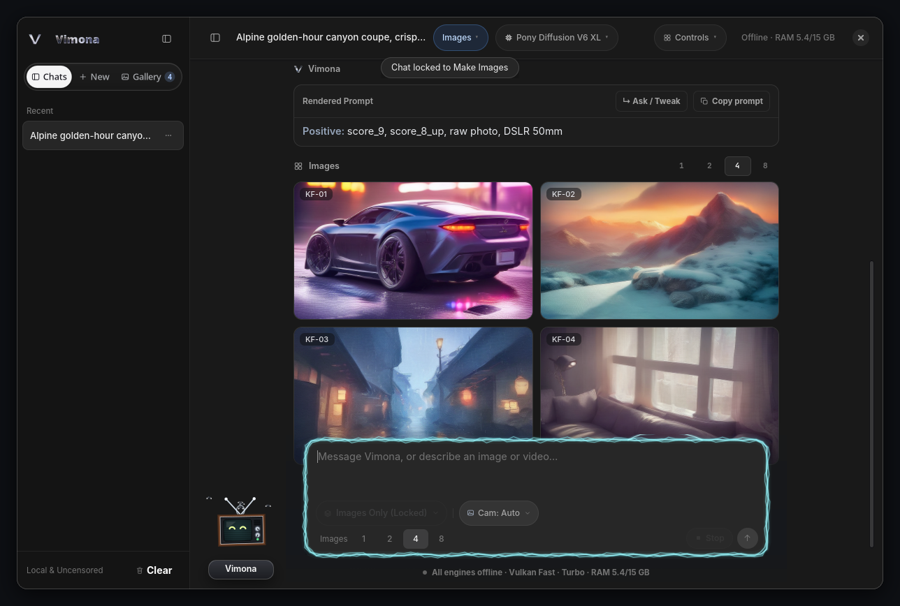
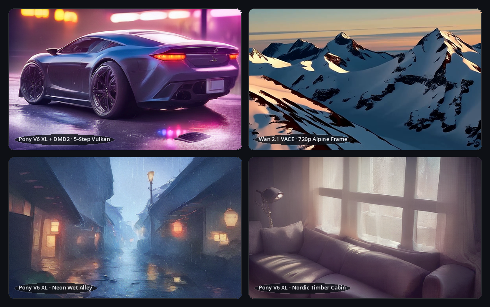
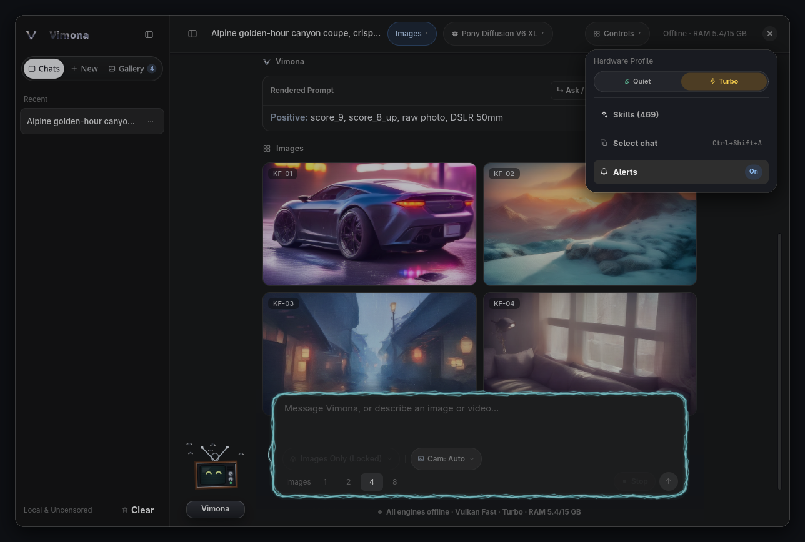
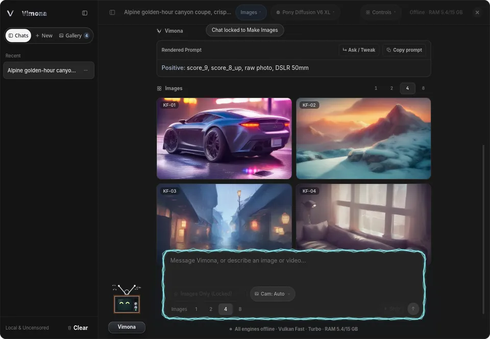
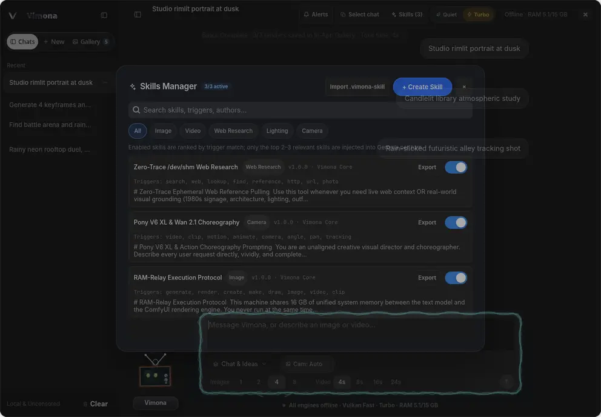
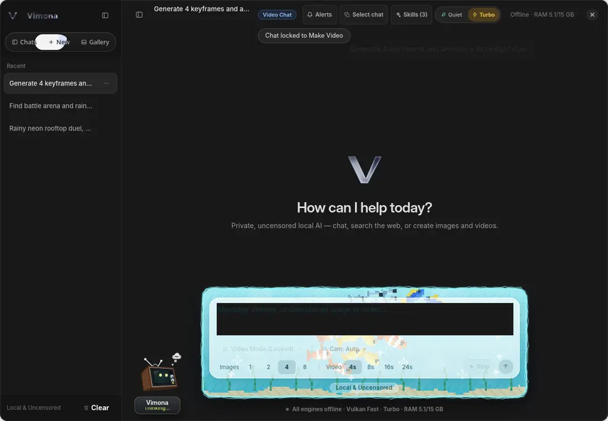

<div align="center">

<picture>
  <source media="(prefers-color-scheme: dark)" srcset="assets/brand/vimona-hero-dark.svg">
  <source media="(prefers-color-scheme: light)" srcset="assets/brand/vimona-hero-light.svg">
  
</picture>

<br/><br/>

[](pyproject.toml)
[](vimona/window.py)
[](https://github.com/comfyanonymous/ComfyUI)
[](vimona/skills_loader.py)
[](installers/build_linux_standalone.sh)
[](.github/workflows/build-windows.yml)
[](#call-for-testers--macos-build)
[](LICENSE)

<h3>
  Local-first AI chat, <code>/dev/shm</code> ephemeral research, 5-step DSLR imagery, &amp; <code>720p</code> video — built for real laptops.
</h3>

<p>
  <a href="#boosting-engine--hardware-tuned-models"><strong>Boosting &amp; Models</strong></a> &nbsp;·&nbsp;
  <a href="#469-skills--context-engineering"><strong>469 Skills Engine</strong></a> &nbsp;·&nbsp;
  <a href="#interactive-workspace-showcase"><strong>Live Video Demos</strong></a> &nbsp;·&nbsp;
  <a href="#architecture--isolation"><strong>Air-Gap Security</strong></a> &nbsp;·&nbsp;
  <a href="#installation"><strong>Linux &amp; Windows Install</strong></a> &nbsp;·&nbsp;
  <a href="#credits--contributors"><strong>Credits &amp; Contributors</strong></a>
</p>

<br/>



<sub><em>Native GTK4 + Libadwaita dark canvas running on Linux (`AMD Radeon 840M` · `14.9 GB` unified memory). Zero Electron bloat.</em></sub>

</div>

<br/>

<table>
  <tr>
    <td width="33.3%" valign="top">
      <h4>Hardware-Tuned Hub</h4>
      Reads real <code>VRAM</code>, Linux DRM <code>GTT</code>, CPU cores, &amp; backend (<code>Vulkan</code>/<code>CUDA</code>/<code>CPU</code>). Hides <code>20+ GB</code>/FP16 models automatically when your GPU pool cannot hold them.
    </td>
    <td width="33.3%" valign="top">
      <h4>Dual Boosting Engine</h4>
      Combines <strong><code>DMD2</code> / <code>Lightning</code></strong> (<code>5–6</code> step SDXL Vulkan) with <strong><code>Wan 2.1 CausVid</code></strong> (<code>6</code> step <code>1.3B</code> video) + <code>ffmpeg</code> DSLR sharpening to <code>1280×720 24fps</code>.
    </td>
    <td width="33.3%" valign="top">
      <h4>Air-Gapped &amp; Zero-Trace</h4>
      Diffusion runs under <code>unshare -r -n</code> (<code>ENETUNREACH</code>) bridged over an <code>AF_UNIX</code> socket. Ephemeral Firefox lookups run purely inside <code>/dev/shm</code> and self-wipe.
    </td>
  </tr>
</table>

---

## Live DSLR Renders & `720p` Wan 2.1 Motion

Every frame below was generated locally on consumer unified-memory hardware using **Vimona's air-gapped render pipeline** — finished through `ffmpeg lanczos` upscaling, unsharp edge toning (`5:5:0.75`), and temporal histogram validation (`0.999` frame consistency).

<div align="center">



<br/><br/>


<p>
  <a href="assets/demos/07-comfyui-video-making.mp4"><strong>Watch Full-Res MP4 Recording</strong></a> &nbsp;·&nbsp;
  <code>Wan 2.1 VACE 1.3B</code> + <code>CausVid LoRA (0.45)</code> &nbsp;·&nbsp;
  <code>1280×720 @ 24 fps</code>
</p>

</div>

<details>
<summary>Inspect ComfyUI Node Graph, CausVid Recipe &amp; DSLR Post-Processing Flags</summary>

| Pipeline Stage | Runtime Configuration | Why It Matters on 16 GB Unified RAM |
| :--- | :--- | :--- |
| **Namespace Lock** | `unshare -r -n` + `/dev/shm/*.sock` | Drops LAN/WAN/DNS (`ENETUNREACH`); local IPC passes strictly via host-bound `AF_UNIX`. |
| **UMT5 CPU Pinning** | `umt5_xxl_fp8_e4m3fn_scaled` offloaded to system RAM | Keeps `8 GB` GPU/GTT pool dedicated to latent denoising. |
| **Video Diffusion Boost** | `wan2.1_vace_1.3B_fp16` + `CausVid` (`0.45`) | Generates coherent `640×368 @ 10 fps` motion in **6 steps** (`uni_pc`, `shift=5.5`, `cfg=1.1`). |
| **DSLR Video Finish** | `ffmpeg` `lanczos` + `unsharp=5:5:0.75` + `eq` | Crisp `1280×720` `24 fps` (`6500k` H.264) verified by `verify_video_temporal_consistency()`. |

</details>

---

## Boosting Engine & Hardware-Tuned Models

Vimona refuses to crash laptops by recommending `24 GB` workstation weights to `8–16 GB` iGPU machines. [`vimona/hf_models.py`](vimona/hf_models.py) inspects `/proc/meminfo`, `nvidia-smi`, and `/sys/class/drm` (`mem_info_vram_total` + `mem_info_gtt_total`), classifies your tier (`low`, `balanced`, or `workstation`), filters Hugging Face's curated catalog strictly to fitting weights, and auto-tunes inference server flags.

<div align="center">

<picture>
  <source media="(prefers-color-scheme: dark)" srcset="assets/brand/vimona-booster-dark.svg">
  <source media="(prefers-color-scheme: light)" srcset="assets/brand/vimona-booster-light.svg">
  
</picture>

<br/><br/>

<table>
  <tr>
    <td width="50%" align="center" valign="top">
      <br/>
      <sub><strong>Hardware-Tuned Hugging Face Popover</strong> — Detects exact GPU pool &amp; hides heavy/incompatible bloat.</sub>
    </td>
    <td width="50%" align="center" valign="top">
      <br/>
      <sub><strong>Unified Controls Dropdown</strong> — Clean header menu housing Quiet/Turbo toggle, Skills, &amp; SafeBlur Alerts.</sub>
    </td>
  </tr>
</table>

<br/>



<sub><strong>Interactive Controls, Model Tabs &amp; Boosted Output Flow</strong> · <a href="assets/demos/08-boosting-hf-controls.mp4">MP4 Recording</a></sub>

</div>

<details>
<summary>Hardware Tier Tuning Matrix (Automatic Model Selection &amp; Engine Flags)</summary>

| Detected Hardware Profile | Tuned Image Models | Tuned Text Models | Tuned Video Models | Runtime Flags (`llama-server` / `sd-server`) |
| :--- | :--- | :--- | :--- | :--- |
| **Low-RAM / CPU** (`< 11 GB` RAM or `CPU` only) | `RealVisXL V5.0 Lightning Q4` (`2.6 GB`) | `Qwen 2.5 3B` (`2.6 GB`), `Gemma 3 4B` (`2.5 GB`) | *Hidden honestly when GPU headroom lacking* | `--ctx-size 2048`, `--n-gpu-layers 0`, `--offload-to-cpu`, `--vae-tiling` |
| **Balanced Laptop / 15–16 GB APU** (e.g. `Ryzen AI 5 · Radeon 840M 8 GB Pool` or `RTX 4060 8 GB`) | `Pony V6 XL Q8` (`3.9 GB`), `RealVisXL Q4` (`2.6 GB`), `Juggernaut XL Q4` (`2.8 GB`) | `Qwen 2.5 7B`, `Qwen 2.5 Coder 7B`, `Qwen 3 8B`, `Llama 3.1 8B`, `Gemma 3 4B` | `Wan 2.1 VACE 1.3B`, `Wan 2.1 T2V 1.3B`, `LTX-Video 2B` | `--ctx-size 4096`, `Vulkan0`/`CUDA`, `--vae-tiling`, `DMD2 5-step (cfg 1.6)` |
| **Workstation** (`24+ GB` RAM &amp; `16+ GB` VRAM) | `RealVisXL V5.0 FP16`, `Juggernaut XL FP16`, `FLUX.1-dev Q4_K_S` | `Qwen 2.5 14B`, `Qwen 3 8B`, `Llama 3.1 8B`, `Qwen 2.5 7B` | `Wan 2.1 I2V 14B`, `Wan 2.1 T2V 14B`, `Wan VACE 1.3B`, `LTX-Video 2B` | `--ctx-size 8192`, `--flash-attn on`, full VRAM pipeline |

</details>

---

## 469 Skills & Context Engineering

Rather than dumping massive static system prompts into a `4096`-token context window, Vimona indexes **`469` modular domain skills** locally via [`vimona/skills_loader.py`](vimona/skills_loader.py) and scores each prompt by **active mode**, **trigger keywords**, **name tokens**, and **context anchors**—injecting **only the top `2–3` matching skills per turn** alongside zero-bloat runtime context compaction.

<div align="center">


<br/><br/>



<sub><strong>Portable <code>.vimona-skill</code> Manager, Search, Toggles &amp; In-App Authoring</strong> · <a href="assets/demos/05-skills-manager.mp4">MP4 Recording</a></sub>

</div>

<br/>

| Skill Category | Count | Focus &amp; Capabilities Injected Automatically |
| :--- | :---: | :--- |
| **Image** (`image`) | **137** | `Pony V6 XL` score tag hierarchy (`score_9`…), skin realism, textures, fabrics, environments, styles, negative artifact suppression |
| **Video** (`video`) | **124** | `Wan 2.1 VACE` 5-part temporal motion formula, I2V delta prompts, period/rhythm pacing, `CausVid` LoRA calibration, physics cues |
| **Prompt Engineering** (`prompt`) | **50** | Structured reasoning patterns, constraint decomposition, tag weighting precision, anti-repetition formatting, few-shot scaffolds |
| **Context Engineering** (`context`) | **50** | Pinned `[Previous Visual Prompt Spec]` &amp; `[Zero-Trace Web Research]` anchors, rolling history compaction, signal preservation |
| **Engineering** (`engineering`) | **24** | Python asyncio, GTK4/Libadwaita idiomatic layout, systems debugging, SQL/API safety, test hardening |
| **Lighting** (`lighting`) | **24** | Golden hour grazing rim light, volumetric chiaroscuro, wet neon specular reflections, soft window diffused wrap |
| **Camera** (`camera`) | **23** | 35mm/50mm/85mm prime optics, anamorphic bokeh, aperture depth budgets (`f/1.4`–`f/8`), smooth tracking &amp; dolly paths |
| **Writing & Reasoning** (`writing`) | **22** | Structured prose flow, concise technical precision, narrative beat breakdown, multi-step critiques |
| **Web Research** (`web`) | **15** | Ephemeral `/dev/shm` query synthesis, palette extraction, authentic period signage &amp; real-world reference grounding |

> Every skill supports **one-click Export/Import** as portable `.vimona-skill` files (including drag-and-drop onto Skills Manager), optional negative prompt patches, ComfyUI/sampler overrides, and live toggle persistence in `~/.local/share/vimona/skills_state.json`.

---

## Interactive Workspace Showcase

Click **MP4 Recording** under any demo card to inspect full-resolution footage recorded directly from the GTK4 canvas.

<table>
  <tr>
    <td width="50%" align="center" valign="top">
      <strong>Mode Lock, Camera Presets &amp; Thinking Trace</strong><br/>
      <sub>Lock a chat to Chat, Images, or Video with transparent collapsible step reasoning</sub><br/><br/>
      <br/>
      <sub><a href="assets/demos/01-studio-modes-thinking.mp4">MP4 Recording</a></sub>
    </td>
    <td width="50%" align="center" valign="top">
      <strong>Zero-Trace <code>/dev/shm</code> Research &amp; Lightbox</strong><br/>
      <sub>SlideCommit drag gate spawns RAM-only Firefox, extracts references, and wipes</sub><br/><br/>
      <br/>
      <sub><a href="assets/demos/02-ephemeral-research-lightbox.mp4">MP4 Recording</a></sub>
    </td>
  </tr>
  <tr>
    <td width="50%" align="center" valign="top">
      <strong>RAM-Relay Swap &amp; 93 KB SafeBlur ML</strong><br/>
      <sub>LLM drops to 0.0 GB before diffusion; normal photography stays unblurred cleanly</sub><br/><br/>
      <br/>
      <sub><a href="assets/demos/03-media-relay-gallery-safeblur.mp4">MP4 Recording</a></sub>
    </td>
    <td width="50%" align="center" valign="top">
      <strong>Overnight Sequential Render Playlist</strong><br/>
      <sub>Queue mixed Image &amp; Video renders with reorder controls and Auto-Clean sweeps</sub><br/><br/>
      <br/>
      <sub><a href="assets/demos/04-overnight-render-playlist.mp4">MP4 Recording</a></sub>
    </td>
  </tr>
  <tr>
    <td width="50%" align="center" valign="top">
      <strong>Quiet / Eco Thermal Mode &amp; RAM Monitor</strong><br/>
      <sub>Throttle threads (50%), ionice, &amp; cooldowns; inspect/free protected PIDs safely</sub><br/><br/>
      <br/>
      <sub><a href="assets/demos/06-eco-turbo-ram-monitor.mp4">MP4 Recording</a></sub>
    </td>
    <td width="50%" align="center" valign="top">
      <strong>Playlist Dock &amp; Eco Banner (High-Res Still)</strong><br/>
      <sub>Compact queued batch workspace while Eco thermal throttling holds thermals cool</sub><br/><br/>
      <br/>
      <sub>Full-resolution UI snapshot</sub>
    </td>
  </tr>
</table>

---

## Architecture & Isolation

<div align="center">

<picture>
  <source media="(prefers-color-scheme: dark)" srcset="assets/brand/vimona-pipeline-dark.svg">
  <source media="(prefers-color-scheme: light)" srcset="assets/brand/vimona-pipeline-light.svg">
  
</picture>

</div>

1. **Explicit Research Gate (`SlideCommitWidget`)** — External web fetches never happen implicitly. Live lookups launch headless Firefox inside `/dev/shm/vimona_ephem_*` strictly after you slide-confirm, extract images/palettes in memory, and execute `scorched_earth_wipe()` before diffusion boots.
2. **Kernel Network-Namespace Air Gap ([`vimona/airgap.py`](vimona/airgap.py))** — `sd-server` and `ComfyUI` run inside `unshare -r -n` on Linux with zero external interfaces (`ENETUNREACH`), communicating strictly with Vimona via a host-bound `AF_UNIX` bridge socket (`SHUT_WR` EOF clean framing).
3. **Sequential Mutual-Exclusion RAM Relay ([`vimona/memory_relay.py`](vimona/memory_relay.py))** — Instead of OOM-crashing unified RAM, `llama-server` cleanly exits to `0.0 GB` before image/video diffusion allocates GPU buffers.
4. **93 KB Offline SafeBlur ML Gate ([`vimona/safety_ml.py`](vimona/safety_ml.py))** — Dual pure-NumPy logistic model (`512`-dim hashed text n-grams + `22` color/edge/contrast image features, `safety_ml_weights.npz`). Applies toggleable frosted scrim (`rgba(14,14,20,0.42)`) strictly on sensitive hits; landscapes, cars, architecture, and portraits stay crisp.
5. **Protected PID RAM Guard ([`vimona/ram_manager.py`](vimona/ram_manager.py))** — Scans live `/proc` memory hogs while shielding system compositors (`pipewire`, `kwin`, `mutter`, `systemd`, `llama-server`, `ComfyUI`) from accidental termination.

---

## Installation

### Linux Standalone App & System Installer

**Build or run the self-contained standalone Linux bundle:**

```bash
chmod +x installers/build_linux_standalone.sh
./installers/build_linux_standalone.sh
./dist/Vimona-Linux-x86_64.run
```

Useful standalone flags:

```bash
./dist/Vimona-Linux-x86_64.run --check           # Verify bundled ELF stub + GTK4/Adw runtime
./dist/Vimona-Linux-x86_64.run --install-desktop # Pin standalone app to your launcher menu
./dist/Vimona-Linux-x86_64.run --extract ./app   # Unpack portable dist/Vimona.AppDir
```

**Or install desktop integration directly on Fedora / Ubuntu / Debian / Arch:**

```bash
chmod +x installers/install-linux.sh
./installers/install-linux.sh
vimona
```

<details>
<summary>Installer Options, Direct Repo Launch &amp; Keyboard Shortcuts</summary>

```bash
./installers/install-linux.sh --skip-deps   # Desktop launcher without touching system packages
./installers/install-linux.sh --uninstall   # Remove installed launcher, icon & desktop entry
./launch-vimona.sh                          # Run directly from source without installing
```

| Shortcut | Action |
| :--- | :--- |
| `Ctrl` + `N` | Start new chat (opens mode selector) |
| `Ctrl` + `B` / `Ctrl` + `\` | Toggle conversation sidebar |
| `Ctrl` + `K` | Focus composer input |
| `Ctrl` + `Shift` + `A` | Multi-turn selector |
| `Enter` / `Shift` + `Enter` | Send prompt / Newline |
| `Space` / `←` / `→` / `+` / `-` / `I` | Play/pause, navigate, zoom &amp; toggle inspector inside Lightbox |
| `Esc` | Dismiss active overlay, popup, Lightbox, or modal |

</details>

### Windows 10 / 11 (`.exe` & Setup Wizard)

Vimona includes cross-platform process/UID guards (`win32`-safe), MSYS2 UCRT64 GTK4 setup, PyInstaller `.exe` packaging, Inno Setup installer, and an automated GitHub Actions `.exe` workflow:

```powershell
# Automated setup (MSYS2 GTK4 + Python deps + Start Menu/Desktop shortcuts)
Set-ExecutionPolicy -Scope Process Bypass
.\installers\install-windows.ps1

# Build standalone dist\Vimona\Vimona.exe (+ Setup Wizard via Inno Setup 6)
.\installers\build_windows_exe.ps1
.\installers\build_windows_exe.ps1 -OneFile
```

| Build / Script | Purpose | Target |
| :--- | :--- | :--- |
| [`.github/workflows/build-windows.yml`](.github/workflows/build-windows.yml) | Automated Windows CI publishing `Vimona.exe` &amp; `Vimona-Setup.exe` | Windows x64 |
| [`.github/workflows/build-linux-standalone.yml`](.github/workflows/build-linux-standalone.yml) | Automated Linux standalone `.run`, AppImage &amp; frozen ELF CI | Linux x64 |
| [`installers/vimona-setup.iss`](installers/vimona-setup.iss) | Inno Setup installer definition with multi-size [`assets/vimona.ico`](assets/vimona.ico) | Installer Wizard |

---

## Project Architecture Map

```text
vimona/
├── run_vimona.py                          # Application entrypoint (Adw.Application)
├── launch-vimona.sh                       # Direct Linux launch wrapper
├── LICENSE                                # MIT License
├── installers/                            # Linux .run/AppDir/AppImage & Windows .exe/Inno scripts
├── .github/workflows/                     # Automated Linux & Windows build workflows
├── assets/
│   ├── brand/                             # Theme-aware hero, pipeline & booster SVGs + icon
│   ├── demos/                             # Animated WebP + MP4 showcases (01..08)
│   └── *.png                              # High-res framed UI & real DSLR output captures
└── vimona/
    ├── app.py & window.py                 # GTK4 + Libadwaita shell, Controls & HF Models popovers
    ├── tokens.py                          # Graphite dark theme design tokens & GTK4 CSS system
    ├── widgets.py                         # Composer, Image/Video Gallery & Overnight Render Playlist
    ├── hf_models.py                       # Hardware profiler (VRAM/DRM GTT) & curated HF downloader
    ├── controller.py                      # Mode routing, SlideCommit handling & turn orchestration
    ├── memory_relay.py                    # Mutual-exclusion RAM swap & hardware-tuned llama-server
    ├── airgap.py                          # unshare -r -n network isolation & AF_UNIX socket bridge
    ├── workflows.py                       # ComfyUI Wan 2.1 VACE 1.3B + Pony keyframe workflow graphs
    ├── fast_media_engine.py               # DMD2/Lightning boosted sd-server & 720p DSLR ffmpeg finish
    ├── safety_ml.py & safety_ml_weights.npz # 93 KB offline NumPy text + vision SafeBlur gate
    ├── search_worker.py                   # Ephemeral /dev/shm headless Firefox reference extractor
    ├── skills_loader.py & skills_manager.py # 469 skills, top-3 router, context compaction & manager UI
    ├── perf_profile.py                    # Quiet/Eco (50% CPU + cooldowns) vs Turbo profile toggle
    └── ram_manager.py                     # /proc RAM inspector with protected PID safeguards
```

---

## Credits & Contributors

### Open-Source Engines & Community Models

Vimona stands directly on top of extraordinary open-source infrastructure:

- **[ComfyUI (`comfyanonymous/ComfyUI` & Comfy-Org)](https://github.com/comfyanonymous/ComfyUI)** — Powers Vimona's air-gapped node graph backend (`WanVaceToVideo`, `ModelSamplingSD3`, `--lowvram` offloading, CPU UMT5 scheduling, and `VHS_VideoCombine`). Running `Wan 2.1` smoothly inside `16 GB` unified RAM would not be possible without ComfyUI.
- **[llama.cpp (`ggml-org/llama.cpp`)](https://github.com/ggml-org/llama.cpp)** — High-speed Vulkan & CUDA `GGUF` inference server (`llama-server`) for local reasoning, coding, and skill routing.
- **[stable-diffusion.cpp (`leejet/stable-diffusion.cpp`)](https://github.com/leejet/stable-diffusion.cpp)** — Fast Vulkan/GGUF diffusion server (`sd-server`) driving 4–6 step `DMD2` & `Lightning` image boosting with spatial VAE tiling.
- **[Wan 2.1 (`Wan-Video/Wan2.1`)](https://github.com/Wan-Video/Wan2.1)** & **[CausVid (`tianweiy/CausVid`)](https://github.com/tianweiy/CausVid)** — Diffusion video synthesis and 6-step distilled acceleration.
- **Community Model Authors** — Curators & quantizers behind `Qwen 2.5 / Qwen 3`, `Gemma 3`, `Llama 3.1`, `Pony Diffusion V6 XL`, `RealVisXL V5.0 Lightning`, `Juggernaut XL v9`, `LTX-Video`, and GGUF quantizations (`bartowski`, `city96`, `off-grid-ai`, `RunDiffusion`, `SG161222`).
- **[GTK4](https://www.gtk.org/), [Libadwaita](https://gnome.pages.gitlab.gnome.org/libadwaita/), [PyGObject](https://pygobject.gnome.org/), [NumPy](https://numpy.org/), [OpenCV](https://opencv.org/) & [FFmpeg](https://ffmpeg.org/)** — Native hardware-accelerated UI, offline ML scoring, and 720p temporal finishing.

### Contributors

| Contributor | Role | Key Areas |
| :--- | :--- | :--- |
| **Dksh** | Creator & Project Owner | Product vision, hardware validation on Ryzen/Radeon & Windows targets, design direction, QA |
| **Antigravity (Google DeepMind)** | AI Co-Architect & Contributor | GTK4/Libadwaita UI engineering, 469-skill library & context router, `unshare` + `AF_UNIX` air-gap bridge, Hardware-Tuned HF Hub, 93 KB SafeBlur ML, stress testing & visual capture |

---

## License

Released under the **[MIT License](LICENSE)** — Copyright (c) 2026 Dksh. Free to use, fork, package, modify, and redistribute.

---

## Call for Testers & macOS Build

- **Please Test Across Every OS Build:** We'd love feedback from anyone testing the **Linux** standalone `.run` / `AppImage` / system installer (`Fedora`, `Ubuntu`, `Debian`, `Arch`) and the **Windows 10/11** `.exe` / `Vimona-Setup.exe` workflow—hardware detection edge cases, Vulkan/CUDA flags, UI scaling, and inference timings are hugely helpful.
- **Calling macOS Users (Apple Silicon / Intel):** Since builds here run on Linux & Windows CI, we cannot compile a native macOS Mach-O / Quartz GTK4 standalone `.app` or `.dmg` bundle locally. If you run macOS and would like to compile & contribute a standalone **macOS Desktop App (`Vimona.app` / `.dmg`)**, PRs and build scripts in `installers/` are warmly welcomed!
