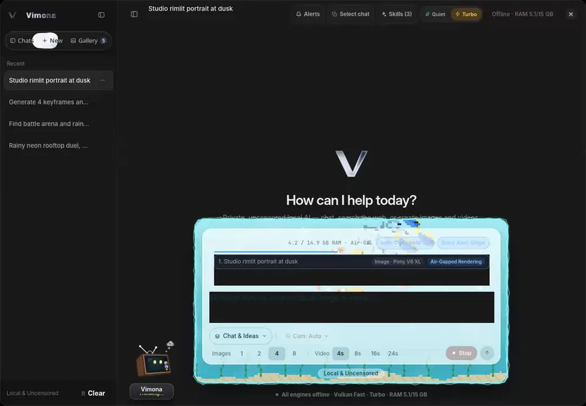
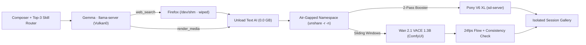

<div align="center">


# Vimona

**Private offline AI studio for Linux — chat, `/dev/shm` visual search, Pony V6 XL imagery, and Wan 2.1 video running sequentially inside 16 GB RAM.**

<p>
  
  
  
  
</p>

[Demos](#-demos) · [Architecture](#-architecture) · [Playlist](#-overnight-render-playlist) · [Skills](#-modular-skills) · [Performance](#-quiet-eco-vs-turbo) · [Run](#-run)

</div>

---

## Demos

<table>
  <tr>
    <td width="50%" align="center">
      
      <br />
      <b>Mode Lock, Live Thinking & Camera Pills</b> · <a href="assets/demos/01-studio-modes-thinking.mp4">MP4</a>
      <br />
      <sub>Lock new chats to Images/Video/Open, watch streamed reasoning, and re-angle shots with one click.</sub>
    </td>
    <td width="50%" align="center">
      
      <br />
      <b><code>/dev/shm</code> Research, Micro-ML Blur & Lightbox</b> · <a href="assets/demos/02-ephemeral-research-lightbox.mp4">MP4</a>
      <br />
      <sub>Zero-disk Firefox sandbox, frosted Gaussian Safe-Blur via local ML, and zoomed RAM Lightbox.</sub>
    </td>
  </tr>
  <tr>
    <td width="50%" align="center">
      
      <br />
      <b>16 GB RAM Relay, Keyframes, Video & Gallery</b> · <a href="assets/demos/03-media-relay-gallery-safeblur.mp4">MP4</a>
      <br />
      <sub>Clean LLM teardown before 2-pass Pony V6 XL rendering, 24fps optical-flow playback, and isolated Gallery.</sub>
    </td>
    <td width="50%" align="center">
      
      <br />
      <b>Overnight Render Playlist & Memory Hygiene</b> · <a href="assets/demos/04-overnight-render-playlist.mp4">MP4</a>
      <br />
      <sub>Ordered queue cards, up/down/cancel controls, between-job RAM sweeps, and one Batch Complete alert.</sub>
    </td>
  </tr>
  <tr>
    <td width="50%" align="center">
      
      <br />
      <b>Modular <code>.vimona-skill</code> Manager</b> · <a href="assets/demos/05-skills-manager.mp4">MP4</a>
      <br />
      <sub>Search, filter, author custom packs with sampler overrides, import/export, and Top-3 dynamic routing.</sub>
    </td>
    <td width="50%" align="center">
      
      <br />
      <b>Quiet / Eco vs. Turbo & RAM Steward</b> · <a href="assets/demos/06-eco-turbo-ram-monitor.mp4">MP4</a>
      <br />
      <sub>Live CPU thread cap + <code>nice</code>/<code>ionice</code> thermal profile switcher and active engine telemetry.</sub>
    </td>
  </tr>
</table>

---

## Architecture

<table>
  <tr>
    <td width="25%" valign="top">
      <b>RAM Relay</b>
      <br /><sub>Passes memory strictly between Gemma (<code>0.0 GB</code> when idle), <code>sd-server</code>, and ComfyUI.</sub>
    </td>
    <td width="25%" valign="top">
      <b>Air-Gapped Netns</b>
      <br /><sub>Media workers boot inside <code>unshare -r -n</code> (no WAN/DNS) via <code>/dev/shm</code> UNIX sockets.</sub>
    </td>
    <td width="25%" valign="top">
      <b><code>/dev/shm</code> Browser</b>
      <br /><sub>Headless Firefox runs purely in RAM for visual refs, then wipes cleanly before rendering.</sub>
    </td>
    <td width="25%" valign="top">
      <b>93 KB Micro-ML Blur</b>
      <br /><sub>Sub-2 ms NumPy/OpenCV text + vision classifier triggers frosted Safe-Blur without false alarms.</sub>
    </td>
  </tr>
</table>



---

## Overnight Render Playlist

- **Queue Control**: Reorder (`↑`/`↓`), cancel (`×`), toggle **`Auto-Clean RAM`**, and choose **`Batch Alert: Single / Per job`**.
- **Lifecycle**: `Queued` → Text unload (`0.0 GB`) & RAM sweep → `Air-Gapped Rendering` → `Consistency Check` (OpenCV frame check on video) → `Cooldown` (Eco) → `Done`.
- **Single Alert**: Suppresses per-render notification spam during batches and fires one privacy-safe `Batch Complete` summary when done.

---

## Modular Skills

Only `enabled: true` packs are indexed; `select_active_skills()` injects the top **2–3 trigger-matched** skills per turn plus negative-prompt and sampler overrides (`cfg`, `sampler`, `flow_shift`, `booster`).

<details>
<summary><b><code>.vimona-skill</code> JSON schema example</b> (drop onto Skills Manager to import)</summary>

```json
{
  "id": "neon-rain-rimlight",
  "name": "Neon Rain Rimlight",
  "version": "1.2.0",
  "author": "vimona-user",
  "category": "Lighting",
  "trigger_keywords": ["neon", "rain", "wet street", "cyberpunk", "night"],
  "system_instructions": "Use high-contrast cyan and magenta rim lighting across wet asphalt reflections and deep shadow falloff.",
  "negative_prompt_patch": "flat lighting, overcast haze, washed out contrast",
  "comfyui_node_overrides": {
    "cfg": 6.0,
    "sampler": "euler_ancestral",
    "flow_shift": 7.5,
    "booster": false
  }
}
```

</details>

---

## Quiet / Eco vs. Turbo

| Metric | Quiet / Eco (`Vulkan Eco · Thermal Cap`) | Turbo (`Vulkan Fast · Turbo`) |
| :--- | :--- | :--- |
| **Worker Threads** | 50% physical/logical core cap (`OMP_NUM_THREADS`, OpenCV, FFmpeg) | 100% available cores |
| **Process Priority** | Linux `ionice -c 3` + `nice -n 12` (`BELOW_NORMAL_PRIORITY_CLASS` Win) | Normal scheduling |
| **Batch Pacing** | `7.0s` inter-job thermal cooldown | Immediate back-to-back |
| **Image Booster** | Single-pass fast render | 2-pass HiRes DSLR detailer + optical finish |

---

## Run

```bash
./launch-vimona.sh
# or
python3 run_vimona.py
```

<details>
<summary><b>Keyboard shortcuts & repository map (34 files in <code>vimona/</code>)</b></summary>

| Keys | Action |
| :--- | :--- |
| `Ctrl` + `N` | New chat + centered Mode Picker |
| `Ctrl` + `K` | Focus composer |
| `Ctrl` + `B` / `\` | Toggle sidebar |
| `Ctrl` + `Shift` + `A` | Select & copy conversation viewer |
| `Esc` | Close active overlay / Lightbox |
| `Left` / `Right` | Previous / next Lightbox item |
| `Space` · `+`/`-`/`0` · `I` | Play/pause video · zoom · metadata drawer |

```text
vimona/
├── app.py, window.py, controller.py        # GTK4 app, workspace, turn & playlist orchestration
├── memory_relay.py, airgap.py              # Zero-overlap 16 GB relay + unshare -r -n AF_UNIX bridge
├── fast_media_engine.py, workflows.py      # 2-pass sd-server booster, 24fps optical flow, Wan VACE graphs
├── search_worker.py, storage.py            # /dev/shm ephemeral Firefox scraper & isolated session staging
├── safety_ml.py, safety_ml_weights.npz     # 93 KB text/vision Micro-ML classifier (zero LLM)
├── safety_blur.py, safety_patterns.py      # GPU frosted Gaussian Safe-Blur + slide-to-reveal gate
├── skills_loader.py, skills_manager.py     # .vimona-skill schema, import/export, Top-3 prompt router
├── perf_profile.py, ram_manager.py         # Eco/Turbo thread & priority enforcement + protected sweeper
├── widgets.py, tokens.py, icons.py         # Composer, Playlist drawer, Gallery, Lightbox & dark palette
└── media.py, models.py, shaders/skills     # OpenCV video decoder, dataclasses, CRT/gooey/metallic FX
```

</details>
